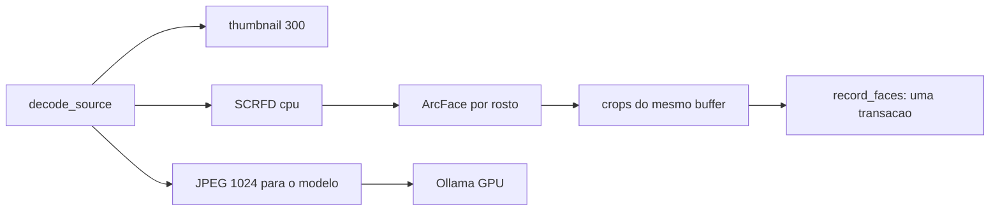

# Plano — leitura de rostos dentro do scan, e o botão em paralelo

Complementa [`pipeline-cpu-gpu-overlap.md`](./pipeline-cpu-gpu-overlap.md) §4.3 e
[`full-pipeline-cut.md`](./full-pipeline-cut.md). Este documento registra o desenho
executado e o que ficou de fora.

> **Status: implementado.** `faces_scanned_at` (migration 18), `record_faces`,
> `copy_faces`, `detect_decoded` / `detect_and_crop`, o pool de workers do botão,
> `FaceEngineGuard`, a opção `face_detection` em `settings.toml` e no menu de
> contexto da raiz, o contador de rostos no painel do backlog e os filtros de
> qualidade. Falta a clusterização incremental (§7).

## 1. O que havia antes

Duas passagens independentes, nenhuma delas reaproveitando trabalho da outra:

| Trabalho | Onde | Custo |
|---|---|---|
| Detecção: `image::open` + EXIF do original | `FaceDetector::detect` | 1 decode completo por foto |
| Pré-processamento: resize 640 + laço `get_pixel` por pixel | `preprocess_scrfd` / `preprocess_arcface` | ~1,2 M escritas de tensor por foto |
| SCRFD + ArcFace | ONNX Runtime **CPU** (o build empacotado não tem CUDA) | ~0,47 s/foto medida no A/B |
| Crops | segundo `image::open` no mesmo arquivo | 1 decode completo por foto **de novo** |
| Escrita | `insert_face_detections` + um `UPDATE` e uma conexão por rosto | 3+ conexões por foto |
| Seleção | `face_count = 0`, por raiz | não enxerga o que o scan deixou pendente |
| Passagem | mono-thread, sequencial | NAS limitado por latência |

O pipeline de classificação, no mesmo período, já decodificava cada foto **uma vez**
(`thumbnail::decode_source`) e tinha em mãos exatamente o `DynamicImage` orientado que
o SCRFD precisa.

## 2. Decisão central: o rosto é um terceiro artefato do mesmo decode

O ganho não está no modelo — está em não pagar duas vezes pelo mesmo trabalho e em
colocar a CPU de rostos dentro da janela em que a GPU está ociosa. Medido antes, em
[`_bench_vision/RESULTS.md`](../_bench_vision/RESULTS.md): produtor 907 ms/arquivo
(578 ms depois do decode compartilhado) contra consumidor 2105 ms/arquivo. Sobra
~1,2 s por foto para o SCRFD, que custa 0,3–0,5 s.

## 3. A opção: `face_detection`

- `settings.toml`: `face_detection = false` (padrão).
- Menu de contexto da raiz: item com marca de seleção, que escreve no
  `settings.toml` pelo mesmo `update_settings` da tela de Settings — os dois pontos
  de entrada não podem divergir.
- `ScanOverrides::face_detection` permite sobrescrever numa execução.
- `ScanContext::face_detection` chega ao produtor; com ele desligado a seleção do
  backlog é **exatamente** a de antes (`include_faces = false`), para que um índice
  cheio de fotos sem rosto não transforme todo passe num passe de rostos.
- Nenhum scan baixa os modelos: sem `buffalo_l` em disco o produtor registra um
  aviso e deixa as linhas pendentes.

O que ficar pendente é lido pelo botão **Detect Faces**, que agora informa quantas
imagens vai processar.

## 4. Um marcador honesto: `faces_scanned_at`

`face_count` era um tri-estado (`0` nunca lido, `-1` lido sem rostos, `>0` com
rostos). Consequências reais:

- um arquivo que falhava ao abrir era gravado como `-1` e **nunca mais** era tentado;
- o botão selecionava `face_count = 0`, então não via essas linhas;
- não havia como perguntar "o que falta?".

Agora `faces_scanned_at IS NULL` é a pendência, `face_count` voltou a ser contagem,
e `mark_faces_scanned` responde "não há rostos aqui" — resposta, nunca falha.

## 5. Escrita e ciclo de vida

- `record_faces(file_id, faces, crops)` faz `DELETE` das detecções da linha e grava
  tudo — inclusive `crop_path`, `face_count` e `faces_scanned_at` — numa transação.
  Re-detectar um arquivo é idempotente.
- Os crops são nomeados `<file_id>_<índice>`, não pelo id do rosto: assim os arquivos
  existem antes das linhas e a transação é uma só.
- `stamp_modified_rows` apaga as detecções, zera `faces_scanned_at` e **devolve** os
  crops órfãos, que o scan remove do disco: um arquivo trocado não pode continuar
  mostrando as pessoas da foto anterior.
- Duplicata por dHash herda os rostos do representante (`copy_faces`), apontando para
  os mesmos crops — que são só leitura.

## 6. Botão multithread

`Session::run` exige `&mut self`, então a inferência não é concorrente na mesma
sessão. A escolha foi **um detector por worker**, com o orçamento de threads
dividido (`cores / workers`, no máximo 4) e um teto de 4 workers, porque cada um
carrega ~180 MB de pesos.

- fila implícita por `AtomicUsize` sobre a lista, então uma foto lenta não trava o
  resto;
- progresso publicado pela mesma `Mutex` que a UI já consulta;
- cancelamento é o mesmo `AtomicBool` de antes;
- crops saem do buffer já decodificado, no mesmo worker.

`FaceEngineGuard` serializa o botão e a detecção inline: dois passes ao mesmo tempo
carregariam dois conjuntos de modelos e escreveriam nas mesmas linhas. Quem chega
depois desiste daquele passe e diz isso no log.

## 7. Qualidade

Antes de gravar, cada rosto passa por dois filtros, sobre o crop já alinhado que o
ArcFace vai consumir (custo ~zero):

- tamanho mínimo de 32 px no lado menor, nas coordenadas do original;
- variância do Laplaciano ≥ 50 no crop 112×112.

É a recomendação de [`_face_ab_test/docs/RESULTS.md`](../_face_ab_test/docs/RESULTS.md)
§4, que mantém 70 % das detecções e evita que um borrão entre numa pessoa. O
alinhamento passou a usar amostragem bilinear: o transform é rotação + escala, e o
vizinho-mais-próximo jogava o alias direto no embedding.

## 8. Invariantes

| invariante | como fica garantido |
|---|---|
| um scan nunca baixa modelos | `face::models_present` antes de criar sessão |
| linha ilegível continua pendente | erro de leitura não chama `mark_faces_scanned` |
| arquivo trocado não mantém rostos | `stamp_modified_rows` apaga e devolve os crops |
| duplicata não paga SCRFD de novo | `copy_faces` no caminho do dedupe |
| um passe de rostos por vez | `FaceEngineGuard` |
| com a opção desligada o backlog não muda | `include_faces = false` na seleção |

## 9. Testes

- `record_faces_replaces_the_previous_detections`
- `mark_faces_scanned_clears_the_pending_marker`
- `stamp_modified_rows_drops_the_faces_and_returns_their_crops`
- `copy_faces_inherits_the_representative_detections`
- `backlog_selects_face_pending_rows_only_when_asked`
- frontend: `RootCard` (item com `aria-checked`), `SettingsModal` (os dois
  checkboxes), `useFaceDetection` (aviso com a contagem pendente)

## 10. Pós-mortem: o produtor que morria

Primeira versão em uso real: dois scans seguidos pararam em 26 arquivos, com
`Backlog: producer thread panicked` e `0 face(s) stored`.

Causa: `ort` com `load-dynamic` carrega a dylib sozinho quando ninguém chama
`init_from`, procurando `libonnxruntime.so` no caminho do loader do sistema. Se não
acha, `ort::setup_api` faz `expect("Failed to load ONNX Runtime dylib")` — **panic**,
não `Err`. O passe manual chama `face::init_ort_from_dir` antes de criar sessões; o
produtor do scan, não. Então a primeira foto que precisava de rosto derrubava a
thread, a fila fechava e o consumidor terminava o passe depois de algumas dezenas de
arquivos — os 26 do log.

Duas correções, ambas no lugar onde o erro nasceu:

1. `ScanContext` passou a carregar `ort_lib_dir` (como já carregava
   `pdfium_lib_path`) e o produtor chama `init_ort_from_dir` antes de qualquer
   sessão. `face::engine_ready` decide a disponibilidade **uma vez por passe**, com os
   modelos e a biblioteca, e loga o motivo em uma linha; sem isso o passe não tenta
   rostos e não pega o engine.
2. `catch_unwind` no trabalho de rosto do produtor e em cada arquivo dos workers do
   botão. Uma biblioteca nativa que panica não pode mais encerrar um passe de 58 mil
   arquivos: o arquivo conta como falha de rosto, fica pendente e o passe continua.

Testes que travam a regressão: `engine_ready_requires_the_models_and_the_runtime` e
`faces_enabled_without_the_runtime_leaves_the_row_pending`.

## 11. Pós-mortem: a ordem dos blocos

Primeiro passe real no acervo (58 593 arquivos): 50 minutos, **0 classificados, 0
thumbnails, 4 914 rostos**. O log mostrava dois blocos com o mesmo `num_ctx`: 3 771 e
54 822 arquivos.

Não era crash — era ordem. `ctx_blocks` montava os blocos das linhas com dimensões
conhecidas primeiro e as "prováveis" (sem dimensões) por último. Com a opção de rostos
ligada, as linhas já classificadas voltaram a ser selecionáveis — e são exatamente as
que têm dimensões gravadas. Resultado: as 3 771 linhas que só precisavam de rostos
viraram o **primeiro** bloco, e as 54 822 que precisavam de classificação ficaram
esperando ~1,5 h, com a GPU ociosa o tempo todo (nada tinha o que classificar na fila).

Correção em dois pontos:

1. `CtxBlock::has_work` e a ordem **trabalho → prováveis → só rostos**. A classificação
   volta a começar no primeiro minuto; o bloco de rostos fecha o passe, quando não há
   mais nada para a GPU fazer.
2. Orçamento de threads por bloco: 1 thread quando o bloco também classifica (o
   pré-processador do Ollama usa os mesmos núcleos), 4 threads quando o bloco é só de
   rostos e a GPU está ociosa. O log diz qual é qual:
   `(already classified: faces only, GPU idle)`.

Custo medido do passe só de rostos, com 1 thread: **~1,6 s por foto** (2,5 rostos por
foto em média). É o número que a opção existe para deixar medir — 58 mil fotos com
rostos ligados é um passe longo, e agora ele aparece atrás do trabalho que importa em
vez de na frente.

A tela da raiz passou a mostrar o contador de rostos junto de thumbnails e
classificados, então as duas visualizações (cartão da raiz e barra lateral) contam a
mesma história.

## 12. Orçamento de threads

Medido no acervo: o bloco só de rostos rodava a **1,56 s por foto** com uma sessão de
uma thread. A conta para 58 mil fotos passa de 26 h, e o pior é que a GPU ficava
parada durante tudo isso.

Duas coisas erradas ali:

1. O produtor é uma thread **porque** o consumidor é um só; num bloco sem nada para
   classificar esse motivo não existe.
2. `intra_threads` satura. O ganho vem de mais imagens em voo, não de mais threads na
   mesma imagem — 1→2 threads ≈ 1,6×, 4→8 ≈ 1,15×, 8→16 ≈ nada.

Agora existe `face_threads` em `settings.toml` (`0` = todos os núcleos, teto 32). Ele é
um **teto**, não uma reserva: [`face::plan_pool`](../sherlock/desktop/src-tauri/src/face.rs)
transforma orçamento em `workers × intra_threads`, com quatro threads por sessão e no
máximo 8 sessões (cada uma carrega ~180 MB de modelos). Onde o orçamento é gasto:

| contexto | threads | por quê |
|---|---|---|
| bloco que também classifica | 1 | o resto é do Ollama, que é o gargalo daquele passe |
| bloco só de rostos | orçamento inteiro, em `plan_pool` workers | nada mais está rodando |
| botão Detect Faces | orçamento inteiro, em `plan_pool` workers | roda sozinho |

Num 16-thread isso dá 4 sessões × 4 threads. O bloco só de rostos deixou de ser um
produtor solitário: [`face_pool_slices`](../sherlock/desktop/src-tauri/src/scan.rs) corta
as linhas em fatias e sobe um produtor por fatia, mantendo o mesmo consumidor, a mesma
guarda de engine e o mesmo cancelamento.

A tela de Settings mostra o que o valor resolve na máquina (`16 thread(s) as 4
session(s) of 4`), então "0 = automático" não é adivinhação.

## 13. Fica para depois

`db::cluster_faces` carrega todos os embeddings e faz o passe de merge entre todas as
pessoas — quadrático no tamanho da biblioteca. Com ~175 mil rostos isso deixa de ser
aceitável. O limite (`FACE_CLUSTER_THRESHOLD`) já saiu do `lib.rs` para um único
lugar, mas a clusterização incremental sobre apenas os rostos novos ainda não foi
feita.
