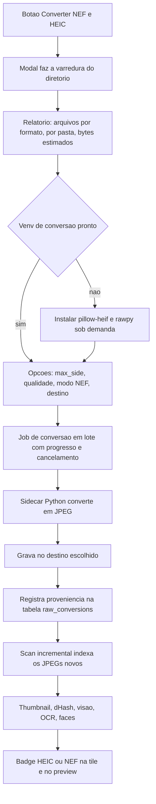

# Conversão opt-in de HEIC/NEF em cópias JPEG

> Abordagem escolhida: em vez de ensinar o pipeline a decodificar HEIC/NEF, o app oferece
> um fluxo explícito que **materializa cópias JPEG** dessas fotos. As cópias entram na
> varredura normal; os originais continuam fora do índice. Este documento cobre a diferença
> entre os dois formatos, o desenho da feature, as decisões e os guardrails.

## 0. Estado da implementação

Implementado e verde. O que existe hoje no código:

| Peça | Onde | Testes |
|---|---|---|
| Sidecar de conversão (lote, `--dry-run`, JSON por arquivo) | [`convert_raw_images.py`](../sherlock/desktop/src-tauri/scripts/convert_raw_images.py) | [`test_convert_raw_images.py`](../sherlock/desktop/src-tauri/scripts/test_convert_raw_images.py) — 16 casos, incluindo conversão real de HEIC e NEF |
| Varredura de candidatos, caminho de saída, probe de escrita, orquestração do lote | [`raw.rs`](../sherlock/desktop/src-tauri/src/raw.rs) | 15 testes unitários |
| Migração 19 (`raw_conversions`) + proveniência na busca + keeper nativo nas duplicatas | [`db.rs`](../sherlock/desktop/src-tauri/src/db.rs) | roundtrip, idempotência, `attach_raw_provenance`, `prefer_native_keeper` |
| Comandos Tauri e provisionamento do venv dedicado | [`lib.rs`](../sherlock/desktop/src-tauri/src/lib.rs), [`platform/python.rs`](../sherlock/desktop/src-tauri/src/platform/python.rs) | `raw_conversion_ready` no `SetupStatus` |
| Modal, entrada no menu da raiz, badge na tile, guarda de clique duplo e ETA | [`RawConversionModal.tsx`](../sherlock/desktop/src/components/modals/RawConversionModal.tsx), [`RootCard.tsx`](../sherlock/desktop/src/components/Sidebar/RootCard.tsx), [`ImageTile.tsx`](../sherlock/desktop/src/components/Content/ImageTile.tsx), [`rawEstimate.ts`](../sherlock/desktop/src/utils/rawEstimate.ts) | 11 testes do modal, 6 da estimativa, 2 do badge, 3 do registro de jobs |

Medido nos arquivos reais (`Fotos Grandes`): HEIC 2252×4000 → 3,5 MB em 310 ms; NEF
4644×3084 → preview embutido de 4608×3072 em **107 ms** (contra 629 ms do demosaico).
`mtime` e EXIF (inclusive o Exif IFD completo) sobrevivem à cópia.

Correções de rota em relação ao desenho original, descobertas na implementação:

- **Preview do NEF não é um mínimo fixo.** A prévia desta câmera tem 99,2 % da resolução do
  raw, então a regra virou "usa o preview quando ele cobre o `max_side` pedido"
  (§5.3). Um mínimo fixo de 2048 px faria demosaicar sem necessidade; nenhum mínimo faria
  rebaixar a resolução em silêncio.
- **O preview do app não precisou de correção.** Como a linha do índice aponta para o JPEG
  convertido (e não para o raw), [`PreviewModal`](../sherlock/desktop/src/components/modals/PreviewModal.tsx:171)
  já renderiza. O problema descrito no §1 só existiria se os raws entrassem no índice.
- **Comando síncrono congela a janela** (reportado no primeiro teste manual). Um
  `#[tauri::command] fn` roda na thread principal: a varredura da pasta, o probe de escrita
  e dois spawns de Python ali travavam o app inteiro. `raw_scan_candidates` e
  `raw_support_status` viraram `async` + `spawn_blocking`; o probe de escrita saiu do
  relatório (escrevia um `.tmp` em cada diretório e trava por minutos em SMB morto) e passou
  para o worker do job; e `start_raw_conversion` só reserva o job e devolve o id — a
  preparação toda acontece na thread de trabalho, com a falha aparecendo no relatório.
- **Estimativas no frontend.** [`rawEstimate.ts`](../sherlock/desktop/src/utils/rawEstimate.ts)
  calcula tempo e bytes a partir dos contadores, então trocar resolução/modo NEF não
  re-varre a pasta (era uma varredura por mudança de select) nem precisa de um probe que
  decodifique amostras.
- **O job repetia a varredura do modal** (segundo teste manual): a janela ficava em
  `0 / ? (0%)` por minutos, o Cancel não fazia nada e não havia log. Agora a lista de
  candidatos do `scan_raw_candidates` é reaproveitada pelo job, o `Cancel` aborta o walk
  (checado no início e a cada 256 entradas), o status tem `phase` (`scanning` /
  `converting` / `done`) e cada transição loga (`raw scan: N candidate(s)`,
  `raw conversion: N candidate(s)`, `converting X of Y`,
  `job N finished: a converted, b skipped, c failed`). Fechar o modal durante o job virou
  **Cancel and close**, e reabrir **reata** ao job em andamento em vez de varrer de novo.
- **Cache pela vida do app, com "Rescan".** O walk não expira por tempo (arquivos HEIC/NEF
  não aparecem com frequência suficiente para justificar re-traversal a cada abertura): a
  lista fica em `AppState` até o app fechar, e o botão **Rescan** passou a ser o único
  caminho para invalidar (`force = true`, que também substitui a lista usada pelo job).
- **Seleção por pasta.** Cada linha do relatório tem checkbox, com um no cabeçalho para
  marcar/desmarcar todas (estado indeterminado quando parcial). Só as pastas marcadas são
  convertidas — o backend recebe a lista e filtra (`filter_candidates_by_dirs`), e o modal
  recalcula totais, tempo e bytes sobre a seleção. Uma lista **vazia é recusada** pelo
  backend: desmarcar tudo e apertar Convert não pode virar uma conversão completa.

## 1. Por que hoje eles desaparecem

24 de 27 fotos de `~/Imagens/Fotos Grandes` (16 HEIC + 8 NEF + 3 MP4) nunca entram no
índice — medido em [`_bench_vision/RESULTS.md`](../_bench_vision/RESULTS.md:75). Duas causas
somadas:

1. **Lista de extensões**: [`SUPPORTED_EXTS`](../sherlock/desktop/src-tauri/src/scan.rs:34)
   tem 20 extensões e nenhuma das duas. A descoberta simplesmente não vê o arquivo.
2. **Decodificador**: o crate `image` 0.25 (usado em
   [`thumbnail::decode_source()`](../sherlock/desktop/src-tauri/src/thumbnail.rs:152),
   [`vision_prep::prepare_with()`](../sherlock/desktop/src-tauri/src/vision_prep.rs:151) e
   [`vision_prep::image_dimensions()`](../sherlock/desktop/src-tauri/src/vision_prep.rs:59))
   **não decodifica nenhum dos dois**. Mesmo com a extensão na lista, a foto viraria uma
   linha sem thumbnail, sem dHash e sem descrição.

Existem mais três pontos que só aparecem depois que a imagem entra no índice:

- [`prepare_from_decoded()`](../sherlock/desktop/src-tauri/src/vision_prep.rs:203) tem dois
  atalhos de "manda o arquivo original sem tocar" (JPEG que já cabe, e `max_side == 0`).
  HEIC/NEF **não podem** cair neles: o Ollama também não lê os dois formatos.
- O WebView mostra o **arquivo original** no preview
  ([`PreviewModal`](../sherlock/desktop/src/components/modals/PreviewModal.tsx:171)) e como
  fallback na tile ([`ImageTile`](../sherlock/desktop/src/components/Content/ImageTile.tsx:42)).
  Nenhum motor de renderização do projeto (WebKitGTK, WebView2, WKWebView) desenha NEF, e o
  WebKitGTK não desenha HEIC.
- A estimativa de varredura conta imagens por extensão em
  [`IMAGE_EXTS`](../sherlock/desktop/src-tauri/src/vision_estimate.rs:34), e a varredura de
  rostos filtra por extensão em SQL ([`db.rs:4261`](../sherlock/desktop/src-tauri/src/db.rs:4261)).

## 2. HEIC x NEF: qual é a diferença

| | **HEIC** | **NEF** |
|---|---|---|
| O que é | Contêiner ISO BMFF (o mesmo da família MP4) com imagens codificadas em **HEVC/H.265** | Contêiner **TIFF** com dados **crús do sensor** (matriz Bayer, 12/14 bits) |
| Padrão | iPhone desde o iOS 11, câmeras recentes e Android | Nikon (NEF); o irmão genérico é CR2, ARW, DNG, ORF, RAF |
| Precisa de | Decodificador HEVC (libheif + libde265/dav1d) | Demosaico (LibRaw/rawpy) **ou** extração do preview JPEG embutido |
| Cor | 10 bits, gamut amplo (Display P3), perfil ICC | Precisa de balanço de branco e matriz de cor da câmera para virar RGB |
| Conteúdo extra | Várias imagens por arquivo: principal, miniatura, burst, mapa de profundidade, trilha de vídeo do Live Photo | Uma ou mais **prévias JPEG** embutidas (frequentemente em resolução cheia) em SubIFDs |
| Tamanho típico | ~metade de um JPEG de qualidade equivalente | 14–50 MB, muito maior que o JPEG final |
| Custo de decodificação | ~80–150 ms por foto | preview: ~5–20 ms · demosaico completo: **1–3 s** |
| Por que o `image` não lê | HEVC + estrutura de caixas | Compressão proprietária da Nikon |

Consequência prática: **HEIC precisa de um decodificador de verdade; NEF normalmente não** —
basta ler o JPEG que já está embutido nele. Isso é o que torna a conversão em lote barata:
o caso caro (demosaico) vira opcional.

## 3. Por que não no fluxo normal

Per-file, o fluxo atual já é dominado por decode + thumbnail + `dHash`
([`decode_source()`](../sherlock/desktop/src-tauri/src/thumbnail.rs:152) e
[`compute_dhash()`](../sherlock/desktop/src-tauri/src/thumbnail.rs:20)). Colocar HEIC/NEF
dentro dele significa:

- uma dependência nativa nova (libheif + codec HEVC) **para todas as plataformas**, no CI
  que hoje baixa pdfium e ONNX Runtime por script
  ([`.github/workflows/release.yml`](../.github/workflows/release.yml:71));
- NEF de 14 MB passando a custar ~2,4 s/arquivo no pior caso (medido em
  [`pipeline-cpu-gpu-overlap.md`](./pipeline-cpu-gpu-overlap.md:323));
- um risco novo no caminho quente que hoje nunca falha por formato.

A conversão em lote move esse risco para um **job explícito, único e retomável**: se falhar,
o usuário vê na hora; o pipeline continua sem saber que HEIC e NEF existem.

## 4. Arquitetura proposta



O pipeline de classificação **não muda**: ele recebe JPEG comum, do jeito que já sabe
processar. Toda a inteligência nova fica em três lugares — descoberta de candidatos, job de
conversão, proveniência no banco.

### 4.1 Backend: comandos novos

| Comando | Retorno | Observação |
|---|---|---|
| `scan_raw_candidates(root_id, force)` | `RawScanReport { dirs: Vec<RawDirCount>, total_files, pending, conversion_ready, … }` | só varre (`walkdir`), **não escreve nada**; `async` + `spawn_blocking`; resultado em cache até o app fechar, `force = true` (botão Rescan) invalida |
| `start_raw_conversion(root_id, options, dirs)` | `job_id` | `dirs` = pastas marcadas (`null` = todas, `[]` é recusado); mesmo padrão de job/cancelamento dos scans |
| `cancel_raw_conversion(job_id)` | `()` | cancelamento cooperativo, para no fim do lote corrente |
| `list_raw_conversions(root_id)` | `Vec<RawConversionRow>` | usado pelo modal e por um eventual filtro |
| `provision_raw_venv()` | progresso por evento | cria venv dedicado e instala `pillow-heif` + `rawpy` |
| `raw_support_status()` | `{ venv_ok, pillow_heif, rawpy }` | entra em `SetupStatus` ([`models.rs`](../sherlock/desktop/src-tauri/src/models.rs:268)) com linha de instrução |

O job emite `raw-conversion-progress` com `{ job_id, done, total, current, out_bytes, failed, skipped }`,
espelhando os eventos de scan já existentes no frontend.

### 4.2 Sidecar Python

`scripts/convert_raw_images.py` (novo, empacotado como resource igual a
[`surya_ocr.py`](../sherlock/desktop/src-tauri/scripts/surya_ocr.py)):

- recebe a lista de arquivos por `stdin`/argumentos e converte **em lote** (um processo para
  N arquivos, não um por arquivo — elimina o custo de startup do interpretador);
- HEIC: `pillow_heif.register_heif_opener()` + Pillow;
- NEF: `rawpy.imread(path).extract_thumb()` quando o preview é JPEG e tem o tamanho mínimo
  pedido; senão `postprocess()` (demosaico);
- grava um JSON por arquivo em `stdout`: `{ source, output, ok, error, width, height, bytes }`;
- `--dry-run` para o modal estimar bytes de saída sem escrever;
- nunca sobrescreve arquivo que não seja dele; nunca apaga nada.

Isso reaproveita exatamente o caminho já validado em
[`_bench_vision/bench_big.py`](../_bench_vision/bench_big.py), que converteu essas mesmas 24
fotos com `pillow-heif` + `rawpy`.

### 4.3 Proveniência no banco

Tabela nova (migração em [`db.rs`](../sherlock/desktop/src-tauri/src/db.rs:221)):

```sql
CREATE TABLE raw_conversions (
    id                INTEGER PRIMARY KEY,
    root_id           INTEGER NOT NULL,
    source_rel_path   TEXT NOT NULL,   -- o HEIC/NEF original, relativo à raiz
    source_ext        TEXT NOT NULL,   -- heic | nef
    output_rel_path   TEXT NOT NULL,   -- o JPEG em FrankSherlock-JPG/, relativo à raiz
    source_size_bytes INTEGER NOT NULL,
    source_mtime_ns   INTEGER NOT NULL,
    output_size_bytes INTEGER,
    max_side          INTEGER NOT NULL,
    quality           INTEGER NOT NULL,
    mode              TEXT NOT NULL,   -- preview | demosaic
    created_at        INTEGER NOT NULL,
    UNIQUE (root_id, source_rel_path)
);
CREATE INDEX idx_raw_conv_output ON raw_conversions (root_id, output_rel_path);
```

A proveniência fica **fora da tabela `files`** de propósito:
[`upsert_file_record`](../sherlock/desktop/src-tauri/src/db.rs:2054) reescreve as colunas da
linha em cada varredura, e um campo novo ali seria zerado silenciosamente. O badge vem de um
`LEFT JOIN` na consulta de busca, ligando `files.rel_path` a `raw_conversions.output_rel_path`.

`SearchItem` ganha dois campos opcionais (`sourceFormat`, `sourceRelPath`) em
[`types.ts`](../sherlock/desktop/src/types.ts:1).

### 4.4 Descoberta das cópias — nenhum mecanismo novo

A cópia mora **dentro da raiz**, em `FrankSherlock-JPG/` no mesmo diretório do original. A
descoberta por `walkdir` já a encontra, o fingerprint já é calculado, o thumbnail já é gerado
e a limpeza já a considera no conjunto visto. É exatamente por isso que esta versão é mais
simples que a anterior: **nenhuma linha de `scan.rs` precisa saber que a cópia é especial.**

A única intervenção é na varredura de *candidatos* (`scan_raw_candidates`), que não pode
descer em `FrankSherlock-JPG/` — os arquivos ali são JPEG e não gerariam candidato, mas
descer neles custa `stat` em rede sem nenhum retorno.

## 5. Decisões

### 5.1 Onde gravar as cópias — decidido: sempre ao lado do original

Decidido: **só existe o destino ao lado do original**. Não há cache de cópias no app data
dir, para não espalhar as imagens em dois diretórios e dois computadores — o usuário quer a
biblioteca centralizada no servidor (e isso conversa com o projeto futuro de servir a mesma
biblioteca para outros dispositivos).

| Item | Valor |
|---|---|
| Caminho | `<raiz>/<dir_original>/FrankSherlock-JPG/IMG_1234__heic.jpg` |
| Quando aparece | sempre, como única opção, com aceite explícito no modal |
| Raiz somente-leitura | **não tem o que fazer**: o modal explica e o job recusa. Não existe fallback. |

Regras do destino:

- Aceite explícito no modal, com dois avisos: *"esta pasta pode ser sincronizada por
  Dropbox/Syncthing/iCloud"* e *"as cópias passam a existir fora do app"* (ver
  [`network-share-hardening.md`](./network-share-hardening.md)).
- O probe de escrita roda por diretório **dentro do worker do job**, uma vez por diretório,
  antes de mandar o lote para o sidecar. Fazer isso no modal custava um `.tmp` por pasta e
  travava por minutos em SMB morto; o diretório que falha entra no relatório como falha
  por arquivo, sem abortar o resto.
- Diretório sem permissão de escrita: listado como "somente leitura, será ignorado", e o job
  segue com os demais. Se **todos** falharem, o botão de confirmar fica desabilitado.
- O `CLAUDE.md` passa a registrar a exceção ao princípio read-only: escrita na raiz é
  permitida **apenas** por esta feature e **apenas** com autorização no modal.

### 5.2 Backend de conversão — recomendado: venv dedicado

| Opção | A favor | Contra |
|---|---|---|
| **Venv Python dedicado** (`pillow-heif` + `rawpy`) | já validado nas 24 fotos; `extract_thumb()` dá preview barato; zero mudança no binário Rust; provisionamento sob demanda já existe ([`run_venv_provision`](../sherlock/desktop/src-tauri/src/platform/python.rs:187)) | requer Python instalado; ~150 MB de venv; mais um passo de setup |
| `ffmpeg` + LibRaw externos | reaproveita a dependência opcional de vídeo | `ffmpeg` não lê NEF; suporte a HEIC depende do build; dois binários novos a documentar |
| Crates Rust (`libheif-rs` + `rawler`) | sem runtime dependency; um caminho só | build nativo (cmake + C++) nos três SOs do CI; `rawler` demosaica em Rust e é lento |

Recomendação: **venv dedicado**, separado do venv do Surya — quem só quer converter NEF não
deve precisar instalar OCR, e um `pip` quebrado não derruba o outro.

### 5.3 Modo do NEF — decidido: `auto`, medido nos arquivos reais

Medido com `DSC_0019.NEF` (4644×3084): o preview JPEG embutido é **4608×3072** — 99,2 % da
resolução do raw — e converte em **107 ms** contra **629 ms** do demosaico, com 1,1 MB contra
1,9 MB de saída. No caso comum o preview não é um compromisso de qualidade.

| Modo | Custo medido | Qualidade |
|---|---|---|
| `preview` (JPEG embutido) | 107 ms | processado pela câmera (cor, contraste, nitidez); 4608×3072 |
| `demosaic` (rawpy `postprocess`) | 629 ms | máxima; permite 16 bits e recupera realces |
| `auto` | 107 ms neste caso | usa o preview quando ele cobre o que foi pedido |

Regra do `auto` (sensível ao `max_side`, não a um mínimo fixo):

- compara o preview com o que o usuário pediu (`max_side`, ou a resolução cheia do raw
  quando `max_side = 0`), com tolerância de 2 % (`PREVIEW_SHORTFALL_TOLERANCE`);
- preview abaixo de 1024 px nunca é usado, mesmo que caiba no pedido;
- se o preview não cobre o pedido, demosaica — é o que evita o rebaixamento silencioso de
  resolução quando o usuário pede a foto inteira.

### 5.4 Nomes — recomendado

- Pasta: `FrankSherlock-JPG` (curto, sem acento, seguro em SMB/Windows). Não usar
  `FrankSherlock-ConvertidasJPG`: acento e comprimento trazem problema em share antigo.
- Arquivo: `<stem>__<ext>.jpg` (ex.: `IMG_1234__heic.jpg`). O sufixo é determinístico (serve
  de chave de idempotência), nunca colide com um JPEG nativo de mesmo nome e deixa a
  proveniência visível fora do app.

## 6. Regras de conversão

1. **Orientação assada no pixel**: aplicar a orientação EXIF na conversão e gravar
   `Orientation = 1`. O pipeline já aplica rotação em
   [`apply_orientation`](../sherlock/desktop/src-tauri/src/exif.rs:128) — sem isso a cópia
   sairia girada duas vezes.
2. **EXIF preservado**: copiar o bloco EXIF do original (ou do preview embutido, que é um
   JPEG completo com EXIF) para a cópia. GPS e `DateTimeOriginal` alimentam
   [`extract_location`](../sherlock/desktop/src-tauri/src/exif.rs:142) e o diálogo de
   propriedades.
3. **`mtime` preservado**: `os.utime(copia, mtime_original)`. A busca `photos from 2022`
   usa `mtime_ns` do arquivo, não o EXIF.
4. **Idempotência**: se já existe linha em `raw_conversions` para `(root_id, source_rel_path)`
   com o mesmo `source_size_bytes` + `source_mtime_ns` e o arquivo de saída existe, pula.
   Mudar `max_side`, qualidade ou modo NEF invalida a linha e reconverte.
5. **Nunca sobrescreve** arquivo que não seja da tabela; em colisão inesperada, falha o
   arquivo com mensagem clara, não sobrescreve.
6. **Cancelamento** para no fim do lote corrente; o que já foi convertido fica (retomada).
7. **Um arquivo por imagem**: HEIC com burst/Live Photo converte só a imagem principal.
8. **Não desce na pasta de saída** (`FrankSherlock-JPG`) durante a varredura de candidatos.
9. **Categoria da cópia**: entra como `photo` normal
   ([`infer_media_type_from_extension`](../sherlock/desktop/src-tauri/src/scan.rs:3013)),
   badge indica a origem.
10. **`output_rel_path` é o caminho real relativo à raiz** (`<dir>/FrankSherlock-JPG/x.jpg`),
    então vale para `abs_path`, thumbnail, árvore e filtros sem nenhum tipo de tradução.
11. **Extensão da cópia é sempre `.jpg`**: mantém `SUPPORTED_EXTS` e o `image` 0.25
    intactos, e é o único formato que o WebView e o Ollama leem em todas as plataformas.
12. **A pasta de saída é do app**: se o usuário apagar `FrankSherlock-JPG/` pelo sistema de
    arquivos, a próxima varredura soft-deleta as cópias (comportamento normal de arquivo
    ausente) e a próxima conversão as recria.

## 7. Guardrails

- **Raiz somente-leitura** (CLI `--read-only`, ver [`plans/startup-scan-prompt.md`](./startup-scan-prompt.md)):
  não há como converter. O item de menu aparece desabilitado com tooltip explicando, e o
  backend recusa o job mesmo que chamado direto. Sem plano B: não se escreve no cache do app.
- **Probe de escrita** por diretório, no worker do job: escreve e apaga um `.tmp` no
  diretório do original. Diretórios que falham entram no relatório final por arquivo, não
  abortam o job.
- **Nada pesado na thread principal.** Varredura, `stat` de rede e spawn de interpretador só
  em `spawn_blocking` ou em thread própria; um comando síncrono do Tauri roda na thread da
  UI e congela a janela (foi o primeiro bug encontrado no teste manual).
- **Um job por raiz, com reserva atômica.** A idempotência do §6.4 protege a segunda
  *execução*, não duas execuções simultâneas: dois cliques (ou duas janelas) calculavam a
  lista de pendentes antes de qualquer linha em `raw_conversions` existir, e dois processos
  `python` escrevendo o mesmo caminho é como um JPEG truncado nasce. O job é reservado no
  mesmo lock que responde "já existe um rodando", antes da varredura (que é a parte cara),
  e a reserva é liberada se o preparo falhar — senão a pasta ficaria "em execução" para
  sempre depois de um erro de venv. No frontend, o botão sai de cena no aceite
  (`jobId != null`), cobrindo a janela de até 700 ms antes do primeiro poll.
- **Espaço em disco**: estimar bytes de saída (`--dry-run` sobre uma amostra) e comparar com
  o livre; avisar quando não couber. 20 mil raws a ~4 MB são ~80 GB.
- **Share de rede**: `stat`/`mkdir` em CIFS morto trava por minutos — o job roda o probe com
  timeout, como [`ROOT_PROBE_TIMEOUT`](../sherlock/desktop/src-tauri/src/scan.rs:71).
- **Sync/backup**: aviso textual no modal ("esta pasta pode ser sincronizada por Dropbox,
  Syncthing ou iCloud").
- **Duplicatas**: a cópia tem `dHash` e pode ser agrupada com um JPEG nativo da mesma foto.
  Nunca deve ser escolhida como *keeper* automático; na view de duplicatas deve aparecer
  ligada ao original (`source_rel_path`).

## 8. Frontend

- **Entrada**: item "Converter NEF/HEIC…" no menu de contexto da raiz na Sidebar
  ([`RootCard.tsx`](../sherlock/desktop/src/components/Sidebar/RootCard.tsx)), junto de
  Rescan/Reclassify, mais um botão na toolbar quando o último relatório da raiz apontou
  candidatos.
- **`RawConversionModal.tsx`** (novo, reaproveitando `shared-modal.css`):
  1. explicação do porquê (com os números reais da varredura: *"16 HEIC e 8 NEF em 2 pastas,
     hoje invisíveis ao índice"*);
  2. opções: `max_side` (original / 2048 / 1600 / 1024), qualidade (80/88/92/95) e modo NEF
     (`auto`/`preview`/`demosaic`). O destino não é opção: é sempre
     `FrankSherlock-JPG/`, com a caixa de aceite e os dois avisos;
  3. estimativa de espaço e de tempo (usa as constantes de
     [`vision_estimate.rs`](../sherlock/desktop/src-tauri/src/vision_estimate.rs:24) mais um
     custo por formato);
  4. estado do venv + botão "Instalar suporte a NEF/HEIC" quando faltar;
  5. durante o job: barra de progresso, `N / M (P%)`, tempo decorrido, tempo restante
     extrapolado da taxa observada e arquivo corrente; botão Cancelar;
  6. no fim: relatório (convertidos, pulados, falhas) e botão "Escanear agora".
- **Badge**: chip `HEIC`/`NEF` em [`ImageTile`](../sherlock/desktop/src/components/Content/ImageTile.tsx:55)
  (padrão já usado para vídeo e rostos) e no
  [`PreviewModal`](../sherlock/desktop/src/components/modals/PreviewModal.tsx:266).
- **Preview**: linha com origem sempre usa `thumbnailPath`/caminho convertido — já é JPEG,
  não depende de suporte do WebView.

## 9. Testes

- Rust: varredura de candidatos (contagem por formato, pula `FrankSherlock-JPG`, ignora
  < 10 KB, marca diretório não gravável), roundtrip de `raw_conversions`, regra de
  idempotência (mesmo mtime+size → pula; mtime novo ou opção diferente → reconverte),
  parsing do JSON do sidecar, cancelamento entre lotes.
- Rust: job em raiz `read_only` é recusado antes de qualquer escrita, e diretório que falha no
  probe é marcado como ignorado sem abortar os demais.
- Rust: registro de jobs — um rodando bloqueia a mesma raiz, um terminado libera a
  retentativa, outra raiz não é bloqueada; e a estimativa de tempo escala com pendentes e
  com `nef_mode = demosaic`.
- Rust, o teste que mais importa: **a cópia entra na varredura seguinte como arquivo comum** —
  duas varreduras seguidas depois da conversão, e a cópia continua viva, com thumbnail,
  dHash e descrição (é o teste que prova que não há linha fantasma nem soft-delete errado).
- Python: teste do script com fixture mínima; sem fixture, `skip` (mesmo padrão de
  [`phase0_verify_env.py`](../_face_ab_test/scripts/phase0_verify_env.py)).
- Frontend: modal (opções, estimativa, estado de instalação), badge na tile, relatório final.
- Smoke opcional (`--ignored`, como o de visão):
  `FRANK_RAW_SMOKE_DIR="$HOME/Imagens/Fotos Grandes" cargo test raw_conversion_smoke -- --ignored --nocapture`
  — deve converter 24 arquivos, indexar, gerar thumbnail/dHash e recusar re-conversão.

## 10. Critérios de aceite

- As 24 fotos de `Fotos Grandes` aparecem na grade com thumbnail, descrição, dHash e (quando
  houver rosto) detecção, sem nenhuma mudança no pipeline de classificação.
- As cópias nascem em `<dir_original>/FrankSherlock-JPG/` e a varredura seguinte as indexa
  como arquivo comum, sem código especial.
- Nenhuma linha de HEIC/NEF entra na tabela `files`; `SUPPORTED_EXTS` continua sem as duas
  extensões.
- Badge e diálogo de propriedades mostram a origem (`HEIC`/`NEF`) e o caminho original.
- Rodar a conversão duas vezes: zero arquivos reescritos, zero linhas novas.
- Raiz somente-leitura: item de menu desabilitado com motivo e job recusado pelo backend;
  nenhum diretório do app é usado como consolo.
- Apagar `FrankSherlock-JPG/` pelo sistema de arquivos: a próxima varredura remove as linhas e
  a próxima conversão recria as cópias.
- Cancelamento no meio deixa o estado consistente e a retomada completa o resto.
- `cargo test` e `npm run test` verdes nos três SOs do CI sem dependência nativa nova.

## 11. Riscos

| Risco | Mitigação |
|---|---|
| Usuário não tem Python instalado | o modal diz exatamente o que instalar, como já faz [`setup_status`](../sherlock/desktop/src-tauri/src/lib.rs:2128); a feature é opcional e o app segue funcionando |
| Pasta de cópias polui a árvore e a grade | pasta fixa e detectável; opcionalmente ocultável na Sidebar; badge distingue |
| Servidor somente-leitura não tem solução | assumido explicitamente: a feature é inútil nesse cenário e o modal diz isso, em vez de prometer um caminho que não existe |
| Cliente de sync envia as cópias para a nuvem | aviso obrigatório no modal e sufixo `__heic`/`__nef` no nome, fácil de excluir em lote |
| Espaço em disco dobrado | estimativa antes de começar + relatório de bytes gravados |
| Cópia "hijack" em duplicatas | `source_rel_path` impede keeper automático |
| NEF sem preview embutido | `auto` cai para demosaico e reporta o custo real no relatório |
| HEIC 10-bit/P3 perder saturação na cópia | converter para sRGB antes do JPEG; comparar visualmente na fase de verificação |

## 12. Fora de escopo

- Decodificar HEIC/NEF inline no pipeline (a alternativa descartada; pode voltar depois sem
  invalidar as cópias já geradas).
- CR2/ARW/DNG/ORF/RAF e outros raws — o desenho aceita (`source_ext` é texto livre), mas a
  primeira entrega é HEIC + NEF.
- Edição ou remoção do original a partir do app.
