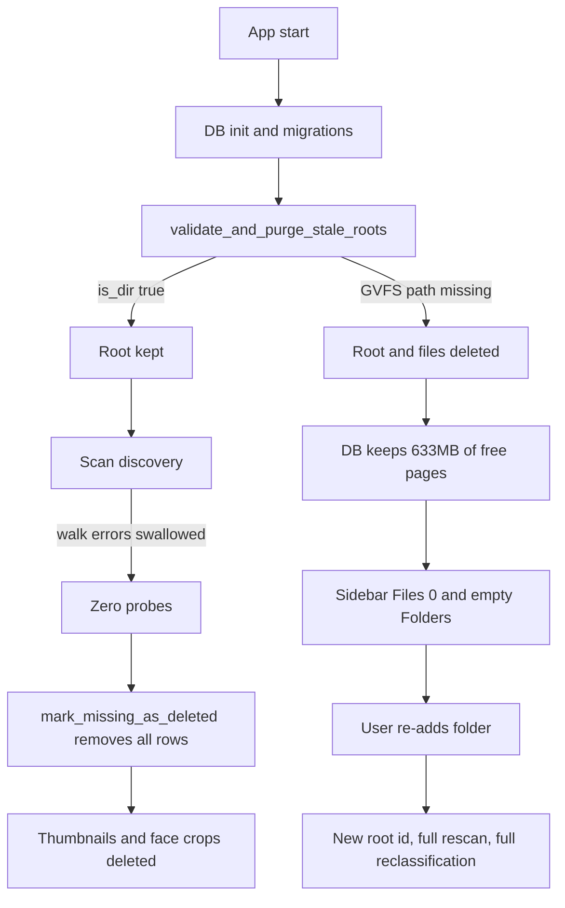

# Frank Sherlock — Network share data loss: diagnosis and hardening plan

Repo: fork of `akitaonrails/FrankSherlock`. Target platform: Ubuntu, photos on a SMB share accessed through GNOME Files (GVFS).

Reported symptom: sidebar shows `DB size: 633 MB` and `Files: 0`, the Folders list is empty, and re-adding the network folder does not reuse previously classified data.

---

## 1. Evidence collected from the code

| # | Location | Behavior |
|---|----------|----------|
| 1 | [`run()`](../sherlock/desktop/src-tauri/src/lib.rs:1729) calls [`validate_and_purge_stale_roots()`](../sherlock/desktop/src-tauri/src/db.rs:1274) on every startup | Any root whose `root_path` is not currently a directory is **hard-deleted** |
| 2 | [`purge_root()`](../sherlock/desktop/src-tauri/src/db.rs:1145) | `DELETE FROM files` (CASCADE removes `face_detections`), `DELETE FROM scan_jobs`, `DELETE FROM roots`, then deletes thumbnail and face-crop files from disk |
| 3 | [`ensure_database()`](../sherlock/desktop/src-tauri/src/lib.rs:145) + [`file_size_bytes()`](../sherlock/desktop/src-tauri/src/lib.rs:158) | `DB size` is the raw file length. SQLite keeps freed pages after `DELETE`; nothing in the repo runs `VACUUM` or sets `auto_vacuum` |
| 4 | [`collect_image_probes_incremental()`](../sherlock/desktop/src-tauri/src/scan.rs:775), line 796 `filter_map(|entry| entry.ok())` | Walk errors are swallowed. An unreadable root yields zero probes and the scan continues |
| 5 | [`mark_missing_as_deleted()`](../sherlock/desktop/src-tauri/src/db.rs:968) + [`cleanup_deleted_caches()`](../sherlock/desktop/src-tauri/src/scan.rs:902) | Zero probes means every row is soft-deleted and thumbnails plus face crops are physically removed |
| 6 | [`load_existing_files()`](../sherlock/desktop/src-tauri/src/db.rs:752) filters `deleted_at IS NULL` | Soft-deleted rows are invisible to the next scan, so every file is treated as `New` |
| 7 | [`upsert_file_record()`](../sherlock/desktop/src-tauri/src/db.rs:848) on conflict | Overwrites `description`, `extracted_text`, `canonical_mentions`, `confidence`, `lang_hint` with the minimal thumbnail-only record (`confidence = 0`) |
| 8 | [`upsert_root_conn()`](../sherlock/desktop/src-tauri/src/db.rs:337) keys roots by exact `root_path` string | A remount at a different path creates a new root; no reuse, no relink |
| 9 | [`adopt_child_files()`](../sherlock/desktop/src-tauri/src/db.rs:401) | Only handles the parent/child path case, not "same share, new mountpoint" |
| 10 | [`generate_thumbnail()`](../sherlock/desktop/src-tauri/src/thumbnail.rs:42) | Thumbnail key is `rel_path` only, so two roots with equal relative paths collide |

### What happened in this specific setup

GVFS paths such as `/run/user/1000/gvfs/smb-share:server=nas,share=photos,user=stephan` exist only while the GVFS SMB mount is alive. After a reboot, logout, session change, or idle unmount, the path disappears and `Path::is_dir()` returns `false`.

Sequence that produced the reported state:

1. Launch with the GVFS mount absent → `validate_and_purge_stale_roots()` sees `is_dir() == false` → root plus every file row deleted.
2. The SQLite file keeps its 633 MB because pages are only returned to the freelist.
3. Re-adding the folder creates a brand-new root with `id` unrelated to the old one, so no classification, album linkage, or face data is reused.

The same symptom appears through a second path: if the mountpoint directory still exists but is empty or returns `ENOTCONN`, a scan discovers zero files and soft-deletes everything, then [`upsert_file_record()`](../sherlock/desktop/src-tauri/src/db.rs:848) wipes classification on the next successful scan.

---

## 2. Failure flow



---

## 3. Immediate recovery runbook (run before any code change)

Do this in order, because the current build purges on launch whenever the share is unavailable.

```bash
# 0) Close the app.
# 1) Snapshot the data directory.
cp -a ~/.local/share/frank_sherlock/db ~/frank-db-backup-$(date +%F)
cp -a ~/.local/share/frank_sherlock/cache/thumbnails ~/frank-thumbs-backup-$(date +%F)

# 2) Inspect the live database.
sqlite3 ~/.local/share/frank_sherlock/db/index.sqlite \
  "SELECT COUNT(*) AS roots FROM roots; \
   SELECT COUNT(*) AS live FROM files WHERE deleted_at IS NULL; \
   SELECT COUNT(*) AS soft_deleted FROM files WHERE deleted_at IS NOT NULL;"

# 3) Inspect the post-scan backup, which may still hold the pre-purge state.
sqlite3 ~/.local/share/frank_sherlock/db/index.sqlite.bak \
  "SELECT id, root_path FROM roots; \
   SELECT COUNT(*) FROM files WHERE deleted_at IS NULL;"
```

Decision tree:

- `.bak` has the expected roots and row count → the data is recoverable. Mount the share **first**, then replace `index.sqlite` + `index.sqlite-wal` + `index.sqlite-shm` with the backup, then launch. Launching before the mount exists purges again.
- `.bak` is already purged as well → rebuild is required, but the code fixes below prevent recurrence.
- Then reclaim disk. `VACUUM` is data-preserving and rewrites the file to its logical size, so it is the right answer for the `0 files / 633 MB` state, where the file is almost entirely free pages. Run it with the app closed:

```bash
sqlite3 ~/.local/share/frank_sherlock/db/index.sqlite \
  "PRAGMA wal_checkpoint(TRUNCATE); \
   INSERT INTO files_fts(files_fts) VALUES('optimize'); \
   VACUUM;"
```

`VACUUM` needs roughly the size of the database free in the same directory, so check `df -h ~/.local/share/frank_sherlock/db` first.

Stopgap until the patched build is installed: mount the share before every launch, and avoid starting a scan while the share is unreachable.

---

## 4. Recommended way to mount the share on Ubuntu

GVFS paths are session-scoped and change with the login user, which makes them a poor root identity for a long-lived index. A systemd automount gives a stable path that resolves lazily on access.

`/etc/cifs-frank.cred` (owned `root:root`, mode `0600`):

```ini
username=stephan
password=CHANGE_ME
domain=WORKGROUP
```

`/etc/fstab` entry:

```
//nas.local/photos  /mnt/nas/photos  cifs  credentials=/etc/cifs-frank.cred,uid=1000,gid=1000,iocharset=utf8,vers=3.0,nofail,_netdev,x-systemd.automount,x-systemd.idle-timeout=600,x-systemd.mount-timeout=15  0  0
```

```bash
sudo systemctl daemon-reload
sudo systemctl restart remote-fs.target
ls /mnt/nas/photos   # triggers the automount
```

`nofail` plus `x-systemd.automount` means boot never blocks and `is_dir()` triggers the mount on demand. `x-systemd.mount-timeout=15` bounds a dead server. The app must still be defensive, because GVFS stays supported and because even fstab mounts can be down.

Alternative, no root required: `gio mount smb://nas.local/photos` then browse `/run/user/1000/gvfs/...`. Keep expecting the path to vanish between sessions.

---

## 5. Local development environment on Ubuntu

The app is Tauri v2 (Rust backend, React frontend). Minimum Rust version is `1.77.2` per [`Cargo.toml`](../sherlock/desktop/src-tauri/Cargo.toml:9).

```bash
# Rust toolchain
curl --proto '=https' --tlsv1.2 -sSf https://sh.rustup.rs | sh
source "$HOME/.cargo/env"
rustup toolchain install stable --component rustfmt clippy
rustc --version

# System packages (mirrors .github/workflows/ci.yml)
sudo apt-get update
sudo apt-get install -y \
  build-essential curl wget file pkg-config libssl-dev \
  libwebkit2gtk-4.1-dev libappindicator3-dev libayatana-appindicator3-dev \
  librsvg2-dev patchelf libgtk-3-dev libsoup-3.0-dev \
  libjavascriptcoregtk-4.1-dev ffmpeg libfuse2 python3-venv

# Node 20 or newer
curl -o- https://raw.githubusercontent.com/nvm-sh/nvm/v0.40.1/install.sh | bash
source "$HOME/.nvm/nvm.sh"
nvm install 24

# Native libraries required at runtime
cd sherlock/desktop/src-tauri
bash scripts/download-pdfium.sh
bash scripts/download-onnxruntime.sh

# Frontend dependencies
cd ..
npm install

# Ollama for classification
curl -fsSL https://ollama.com/install.sh | sh
ollama serve &
ollama pull qwen2.5vl:7b
```

Useful commands:

```bash
cd sherlock/desktop/src-tauri && cargo test          # Rust suite
cd sherlock/desktop && npm run test                  # frontend suite
cd sherlock/desktop && npm run tauri:dev             # dev run
cd sherlock/desktop && npm run tauri:build           # AppImage and bundles
```

Notes:

- `WEBKIT_DISABLE_DMABUF_RENDERER=1 GDK_BACKEND=wayland,x11 npm run tauri:dev` if the window is blank on Wayland with NVIDIA.
- To test against a scratch database instead of the real one: `FRANK_SHERLOCK_DATA_DIR=/tmp/frank-test npm run tauri:dev`.
- `offline` behavior can be simulated by pointing a root at a directory and then renaming it, or by `gio mount -u smb://...` while the app runs.

---

## 6. Implementation plan

### Phase 1 — stop the data loss (backend)

1. **Migration 13 in [`db.rs`](../sherlock/desktop/src-tauri/src/db.rs:66)** (append only, never edit earlier entries):
   `roots.availability TEXT NOT NULL DEFAULT 'unknown'`, `roots.last_seen_at INTEGER`, `roots.last_error TEXT`. Extend `RootInfo` in [`models.rs`](../sherlock/desktop/src-tauri/src/models.rs) with `availability`, `last_seen_at`, `last_error`.
2. **Replace the destructive startup validation**: rename `validate_and_purge_stale_roots` to `probe_roots`, never delete. Set `availability = 'offline'` plus `last_error` when the path is missing, `'online'` plus `last_seen_at` otherwise. Remove the call site and all thumbnail removal from [`run()`](../sherlock/desktop/src-tauri/src/lib.rs:1729). Keep [`purge_root()`](../sherlock/desktop/src-tauri/src/db.rs:1145) reachable only through the explicit `remove_root` command, and make the delete confirmation state that thumbnails and classification are permanently removed.
3. **Scan preflight and safety guard** in [`scan.rs`](../sherlock/desktop/src-tauri/src/scan.rs:65):
   - Preflight `read_dir(root)` in a worker thread with `mpsc::recv_timeout` so a hung CIFS call becomes a timeout instead of a freeze; on failure mark the root offline and fail the job with a clear message.
   - Count `WalkDir` `Err` entries instead of dropping them. Any error under the root aborts the job before phase 4.
   - Abort with `RootUnavailable` when `probes.is_empty()` and the DB holds rows for that root, or when discovered files fall below a safety ratio of existing rows (configurable, default 50 percent, only applied above 100 existing files). Never run [`mark_missing_as_deleted()`](../sherlock/desktop/src-tauri/src/db.rs:968) when discovery was partial.
4. **Revive soft-deleted rows instead of overwriting**: [`load_existing_files()`](../sherlock/desktop/src-tauri/src/db.rs:752) returns deleted rows too with a `deleted_at` flag. In the `FileStatus::New` branch, if a soft-deleted row matches on `rel_path` and `size_bytes` (and fingerprint when mtime differs), call a new `restore_file_by_id` that clears `deleted_at`, updates `abs_path`, `mtime_ns`, `scan_marker` and keeps the classification. This alone prevents LLM re-runs after any future accent.
5. **Root identity normalization** in [`config.rs`](../sherlock/desktop/src-tauri/src/config.rs:279): normalize trailing slashes before storage; add a unit test covering gvfs-style paths with `,` and `=` characters. Do not case-fold on Linux.

### Phase 2 — relink and reuse

6. **`relink_root(root_id, new_path)` command** in [`db.rs`](../sherlock/desktop/src-tauri/src/db.rs) and [`lib.rs`](../sherlock/desktop/src-tauri/src/lib.rs:377):
   - Canonicalize the new path, reject it if another root already uses it.
   - In one transaction update `roots.root_path`, `roots.availability`, `scan_jobs.root_path`, and every `files.abs_path` by replacing the old prefix with the new one.
   - Leave `scan_marker` alone so a following metadata-only scan validates quickly without reclassifying.
7. **UI for offline roots and relink**: extend [`types.ts`](../sherlock/desktop/src/types.ts) and [`RootCard.tsx`](../sherlock/desktop/src/components/Sidebar/RootCard.tsx) with an `Offline` badge, last-seen timestamp, and a `Locate…` action that opens the folder picker and calls `relink_root`. Add a `RelinkRootModal` and wire it through [`useScanManager.ts`](../sherlock/desktop/src/hooks/useScanManager.ts) and [`App.tsx`](../sherlock/desktop/src/App.tsx). When a picked folder is new but offline roots exist, offer "reuse existing index" before creating a fresh root.
8. **Accurate storage stats and database compaction**:
   - Report `logical_size` (`page_size * (page_count - freelist_count)`) and `free_pages` next to the raw file size, plus the `-wal` size, so a purged database no longer looks full.
   - Add `compact_database()` in [`db.rs`](../sherlock/desktop/src-tauri/src/db.rs) exposed as a Tauri command: `require_writable`, `wal_checkpoint(TRUNCATE)`, `INSERT INTO files_fts(files_fts) VALUES('optimize')`, then `VACUUM`, returning before and after byte sizes. Map a `SQLITE_FULL` or I/O error to a readable message instead of failing silently.
   - Do not run it at startup: it rewrites the whole file, needs free space roughly equal to the current file size, and blocks other writers.
   - Surface it in the sidebar Info block as a `Compact` action, offered automatically when `freelist_count / page_count` is above a threshold (for example 0.25) and the file is larger than a few tens of MB.
   - Add `PRAGMA auto_vacuum = INCREMENTAL` in the migration hook, documenting that it only takes effect once a `VACUUM` runs, after which `PRAGMA incremental_vacuum` keeps the file from growing back after future deletes.

### Phase 3 — Linux and network polish

9. **`platform/fs.rs`** (new module, registered in [`platform/mod.rs`](../sherlock/desktop/src-tauri/src/platform/mod.rs)) holding all OS-specific filesystem logic: timeout-bounded availability probe, mount type detection from `/proc/mounts` (`cifs`, `smb3`, `fuse.gvfsd-fuse`), and the tolerance policy used for mtime comparison.
10. **Non-blocking startup**: move root probing off the pre-window path in [`run()`](../sherlock/desktop/src-tauri/src/lib.rs:1706) into a background task that emits an event and is reflected by `roots.availability`.
11. **Tolerant mtime for network roots**: when the mount type is a network filesystem, treat `mtime_ns` within a small tolerance and equal `size_bytes` as unchanged, to avoid perpetual re-thumbnailing on servers that truncate timestamps.
12. **Thumbnail collisions**: move thumbnails under a per-root subdirectory and migrate existing rows and files in a background task, so purging or deleting in one root cannot delete another root's thumbnails. Also fix the dead `thumbnails_dir/<root_name>` cleanup in [`validate_and_purge_stale_roots`](../sherlock/desktop/src-tauri/src/db.rs:1284).
13. **Documentation**: add `docs/network-shares-linux.md` (fstab automount versus GVFS, credentials, timeouts, relinking) and `docs/dev-setup-linux.md` (section 5 of this plan), and link both from [`README.md`](../README.md:40).

### Testing

- Rust unit tests: probing never deletes rows; offline marking; scan abort on empty or partial discovery; revive-soft-deleted preserves `description` and `confidence`; relink rewrites `abs_path` and `scan_jobs.root_path`; storage stats logical size; migration 13 idempotent on an existing DB.
- Frontend tests: offline badge rendering, relink modal happy path and duplicate-path rejection, `Files: 0` plus offline root no longer shown as "No folders scanned yet".
- Manual Linux test: GVFS mount, `gio mount -u`, relaunch, confirm the root survives as offline; remount at a different gvfs path, relink, confirm no reclassification (survival of `confidence` values in `sqlite3`).

---

## 7. Open decisions

1. Whether to keep diagnosing data in place first (recommended) or immediately rebuild the index. This machine reports `Files: 0`, so `VACUUM` reclaims the 633 MB either way; the only question is whether `index.sqlite.bak` still holds the pre-purge rows.
2. Whether `x-systemd.automount` is acceptable on this machine, since it requires root and a credentials file.
3. Whether thumbnail layout migration (item 12) ships in the same change or a follow-up.

---

## 8. Upstream PR strategy

The work is worth sending upstream: it is a reproducible data-loss bug, not a preference. Because item 5 changes existing behavior, split it so the maintainer can accept the safe fix independently of the UI and the schema additions.

1. **Issue first**: describe the GVFS scenario with steps (root on `/run/user/1000/gvfs/smb-share:...`, reboot or `gio mount -u`, relaunch, roots and files gone, `DB size` unchanged) and state the proposed behavior change: mark roots offline instead of purging. This avoids a PR that argues with an intentional design.
2. **PR 1, smallest and highest value**: never purge roots automatically, add `roots.availability`, `last_seen_at`, `last_error` via an appended migration, expose the offline state in `RootInfo` and `RootCard`, plus tests. No relink yet.
3. **PR 2**: abort scans on failed or collapsed discovery (preflight, walk error counting, safety ratio before `mark_missing_as_deleted`).
4. **PR 3**: preserve classification for soft-deleted rows by reviving them instead of overwriting with `confidence = 0`.
5. **PR 4**: `relink_root` command plus the `Locate…` flow, the only PR with meaningful new UI.
6. **PR 5**: accurate storage stats, `compact_database`, FTS optimize.
7. **PR 6, optional and last**: per-root thumbnail layout. It moves cache paths, needs a migration task, and is the riskiest for review, so keep it out of the first batch.

Conventions to respect for every PR, per [`CLAUDE.md`](../CLAUDE.md):

- Append migrations in [`db.rs`](../sherlock/desktop/src-tauri/src/db.rs:66) only; never edit or reorder existing entries, and test both a fresh database and an upgraded one.
- Keep OS-specific logic inside `src-tauri/src/platform/`; CI runs Linux, macOS and Windows on every push.
- Gate with `cargo fmt --check`, `cargo clippy -- -D warnings`, `cargo test`, `npm run test`, `npm run build`.
- Do not bump the version or add release notes; the maintainer tags releases and updates `releases/vX.Y.Z.md`.
- Branch from the fork's `main` kept in sync with upstream, one topic per branch, conventional commit messages, and a PR description that links the issue and includes the sqlite3 output before and after.
