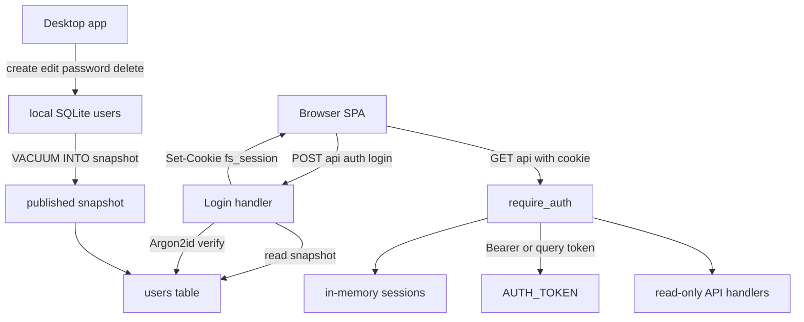
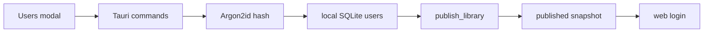

# User accounts for the web client

## Goal

Replace the single shared access token as the only way into the web app with accounts
managed in the desktop app:

- a `users` table with name, login, password hash and timestamps;
- a desktop screen to create, edit, change password and delete users;
- a web login screen with login + password;
- the existing `AUTH_TOKEN` remains as an optional read-only API token for scripts and
  automation;
- the web stays read-only: no user management on the web.

## Non-goals for this change

- No admin role, hidden-item visibility or per-user permissions. That is a later change
  and will need its own migration and core query work.
- No self-service password reset or password change in the web app.
- No web endpoint that writes users. The desktop remains the only writer.
- No change to the publish layout beyond the users table travelling inside the snapshot.

## Decisions

1. **Passwords are hashed with Argon2id** in `sherlock_core`, so the desktop hashes and the
   web server verifies with the same implementation. The stored value is a PHC string;
   plaintext passwords never reach the database, the snapshot or a log.
2. **User sessions use an HttpOnly cookie**, not a bearer token stored in localStorage.
   `` and `<video>` cannot send an `Authorization` header, and a cookie removes the
   need to put a session secret in a URL. The cookie is `HttpOnly`, `SameSite=Strict`,
   `Path=/`, with a finite lifetime.
3. **`AUTH_TOKEN` stays permanently** as a read-only API token. It is accepted as
   `Authorization: Bearer …` and as `?token=`, exactly as today, and it never grants user
   management or hidden-item access. `?token=` remains the quiet bootstrap path for
   existing deployments and for media requests made by scripts.
4. **Users travel in the published snapshot.** The desktop owns the users table; the web
   server only reads the revision that `current.json` points at. A user change reaches the
   web after the next publish, the same rule as any other index change.
5. **Login is JSON-only** and answers the same generic `401` for an unknown login and a
   wrong password. This avoids user enumeration and makes a cross-site HTML form unable to
   perform a login request without a CORS preflight.
6. **Sessions are in memory** in the web server. A restart logs everyone out, which is
   acceptable for a read-only viewer and avoids a writable session database on the
   read-only library mount. Sessions are validated against the current published user
   directory, so deleting a user or changing a password invalidates that user's sessions
   after a publish.

## Data model

Migration 26 in `sherlock/core/src/db.rs`:

```sql
CREATE TABLE IF NOT EXISTS users (
    id            INTEGER PRIMARY KEY AUTOINCREMENT,
    name          TEXT NOT NULL,
    login         TEXT NOT NULL COLLATE NOCASE UNIQUE,
    password_hash TEXT NOT NULL,
    created_at    INTEGER NOT NULL,
    updated_at    INTEGER NOT NULL
);
```

`COLLATE NOCASE` makes `Alice` and `alice` the same account while preserving the spelling
the user typed. No `is_admin` column yet: an unused column would be a promise the product
does not keep. A later migration can add it.

Core row shape (`sherlock/core/src/models.rs`):

```rust
pub struct User {
    pub id: i64,
    pub name: String,
    pub login: String,
    pub created_at: i64,
    pub updated_at: i64,
}
```

`password_hash` is never part of this struct. The web server uses a separate internal
credential row so it can verify the password without ever serializing the hash.

## Password module

New `sherlock/core/src/auth.rs`:

- `hash_password(password) -> AppResult<String>` using Argon2id and a random salt;
- `verify_password(password, phc_string) -> bool`, returning false for malformed hashes;
- `validate_password(password) -> Result<(), String>` with a minimum length of 8 and a
  maximum of 256 characters;
- validation helpers for name and login, or these can live next to the Tauri commands.

Add `argon2 = "0.5"` to `sherlock/core/Cargo.toml`.

## Desktop side

### Backend commands

In `sherlock/desktop/src-tauri/src/lib.rs`, all behind `require_writable`:

- `list_users`;
- `create_user(name, login, password)`;
- `update_user(user_id, name, login)`;
- `set_user_password(user_id, password)`;
- `delete_user(user_id)`.

Validation rules:

- name after trim: 1–120 characters;
- login after trim: 3–64 characters, no whitespace or control characters;
- password: 8–256 characters;
- duplicate login is reported as a user-facing error, not an internal SQLite message.

Hashing is CPU-bound, so the commands should run it on a blocking task rather than on the
IPC thread. The registration list in `invoke_handler` must include the new commands.

Deleting the last user is allowed, but the desktop shows a warning: if the deployment has
no `AUTH_TOKEN`, the web cannot be entered again until another user is created and
published.

### Desktop UI

- New `UsersModal` under `sherlock/desktop/src/components/modals/`.
- A `User` type and API wrappers in `sherlock/desktop/src/types.ts` and
  `sherlock/desktop/src/api.ts`.
- A new optional `onOpenUsers` entry in the shared sidebar footer, next to Settings.
  The desktop passes it; the web does not, so the web sidebar stays unchanged.
- The modal lists users, creates one, edits name/login, changes a password and deletes
  with an inline confirmation.
- Empty state: "No users yet. Create the first account; the web can only sign in after a
  publish."
- A persistent hint in the modal: "Changes reach the web with the next library publish."
- Read-only database mode disables all mutations and says why.

### Publish

No production change is expected: `VACUUM INTO` copies the whole database, including the
new table. Add a regression test next to the existing publish tests that creates a user,
publishes and reads the row back from the snapshot. This makes the users table's presence
an asserted part of the publish contract.

## Web server side

### Auth module

New `sherlock/web/server/src/auth.rs`:

- `Principal::{ApiToken, User(SessionUser)}`;
- `SessionStore` with opaque random session ids and expiry;
- cookie parsing and serialization for `fs_session`;
- a `UserDirectory` cached by published revision, mapping login to credentials and user id
  to credentials;
- login/logout/me handlers.

Dependencies: add `uuid = { version = "1", features = ["v4"] }` for session ids. Cookie
handling and Argon2 verification come from `sherlock_core`.

### Middleware

`require_auth` in `sherlock/web/server/src/api.rs` accepts, in order:

1. the configured `AUTH_TOKEN`, by header or `?token=`;
2. the `fs_session` cookie, if it maps to a live session whose user still exists in the
   current published revision and whose password hash has not changed.

A valid principal is inserted into the request extensions. `/api/auth/me` reads it; the
rest of the handlers do not need it because the web remains read-only and all users see
the same visible library.

### Public and protected routes

Public:

- `POST /api/auth/login` with `{ "login": "...", "password": "..." }`;
- `POST /api/auth/logout`.

Protected:

- `GET /api/auth/me`;
- every existing `/api` read endpoint.

Login flow:

- load the current snapshot;
- load the user directory for that revision;
- if the users table is missing, answer `503` with a message telling the operator to
  publish from an updated desktop build;
- if the login is unknown, still perform a dummy Argon2 verification and answer `401`;
- if the password is wrong, answer `401`;
- on success, create a session, answer the user shape and set the cookie.

Cookie flags:

- `HttpOnly`, `SameSite=Strict`, `Path=/`;
- `Secure` when `COOKIE_SECURE` is enabled or a trusted `X-Forwarded-Proto: https` says the
  request arrived over TLS;
- lifetime of 30 days, with cleanup of expired entries on access.

`AUTH_TOKEN` remains optional. An empty token plus an empty published users table means the
API is closed to everyone, which is safe and must be explained by the login error.

### Session validation and password changes

The session stores the user id and the password hash it was created with. On each request
the middleware compares that against the directory for the current revision:

- user deleted → session removed and `401`;
- password changed → session removed and `401`;
- new revision with the same user and hash → session stays valid.

The directory is loaded once per revision and cached, so this does not turn every media
request into another database read.

## Web client side

### Shared HTTP client

`sherlock/shared/src/httpClient.ts`:

- add a `credentials` option, defaulting to `"same-origin"`, and pass it to `fetch`;
- keep the optional `token` option; when it is absent, URLs stay clean and the browser
  sends the session cookie instead;
- keep `?token=` on media URLs only in token mode;
- keep the `401` callback that returns the user to the login screen.

### Auth gate

Rename `TokenGate.tsx` to `AuthGate.tsx` and update `main.tsx` and its tests.

State machine:

1. try `GET /api/auth/me` with the session cookie;
2. if that fails, and a `?token=` is present, store it and try token mode;
3. otherwise, if a stored token exists, try token mode;
4. otherwise show the login form.

Login form:

- user + password fields by default;
- a link to switch to "Use an access token instead";
- the token mode keeps the current validation-before-storage behaviour;
- `?token=` links still work once, are stored and removed from the address bar.

Sign out:

- user session: `POST /api/auth/logout`, then show the login screen;
- token mode: clear the stored token;
- clear both the cookie session and the stored token so the next visit starts clean.

### Web shell

`sherlock/web/ui/src/App.tsx` receives the current session and a sign-out callback from
`AuthGate`:

- show the account name or "API token" in the top bar;
- add a Sign out button;
- keep the footer's read-only label.

Update the auth CSS for the two login modes, the account label and the sign-out button.

## API contract

```text
POST /api/auth/login
  request:  { "login": "ana", "password": "..." }
  response: { "kind": "user", "id": 1, "name": "Ana", "login": "ana" }
  errors:   401 invalid credentials
            503 no published users table / library unavailable

GET /api/auth/me
  response: { "kind": "user", "id": 1, "name": "Ana", "login": "ana" }
            { "kind": "token", "name": "Access token" }
  errors:   401 no valid session or token

POST /api/auth/logout
  response: 204 and an expired fs_session cookie
```

All existing `/api` reads keep their current shapes. Token authentication keeps the
current `Authorization: Bearer …` and `?token=…` forms.

## Flow





## Security notes

- Argon2id is the primary brute-force cost. Login answers generically and does not reveal
  whether the login exists.
- JSON-only login prevents a plain cross-site HTML form from submitting credentials.
- Cookie sessions are HttpOnly, so a script injected into the page cannot read them.
- The snapshot contains password hashes. The publish folder must be readable only by the
  container user and the desktop user; this is now part of the deployment documentation.
- `?token=` still leaks into proxy and browser logs. It remains for compatibility and
  scripts; user sessions should use the cookie path. Documentation keeps recommending TLS
  and an authenticating reverse proxy.
- Passwords are never written to `config.json`, logs, URLs or the snapshot in plaintext.

## Test plan

Core:

- migration creates `users` and bumps `user_version` to 26;
- user create/list/update/password/delete round trip;
- login uniqueness is case-insensitive;
- Argon2 hash is not the plaintext and verifies correctly;
- malformed hashes fail closed.

Desktop backend:

- commands reject empty name/login, short passwords and duplicate logins;
- password change replaces the hash and never returns it;
- publish snapshot contains users;
- read-only mode refuses mutations.

Desktop UI:

- empty state, create, edit, password change and delete confirmation;
- error message for duplicate login;
- read-only mode disables actions;
- the publish hint is present.

Web server:

- unauthenticated request is `401`;
- user login sets a cookie and `/api/auth/me` returns the user;
- wrong password is `401` and sets no cookie;
- cookie authenticates search, media, thumb and item;
- token still authenticates by bearer and by `?token=`;
- logout invalidates the session;
- a deleted user or changed password invalidates the session after the next revision;
- a missing users table answers a clear `503`.

Web client:

- login form submits user credentials;
- token mode validates before storing;
- `?token=` signs in once and is stripped from the URL;
- sign out returns to the form;
- `httpClient` sends credentials and leaves media URLs clean in session mode;
- `401` from a library call brings the form back.

## Implementation checklist

1. Add `argon2` to `sherlock/core/Cargo.toml` and create
   `sherlock/core/src/auth.rs` with hashing, verification and validation helpers.
2. Export the auth module from `sherlock/core/src/lib.rs`.
3. Add the `User` model to `sherlock/core/src/models.rs`.
4. Add migration 26 with the `users` table and update the schema-version assertion to 26.
5. Add user CRUD and credential lookup functions to `sherlock/core/src/db.rs`, with tests.
6. Add the Tauri user commands to `sherlock/desktop/src-tauri/src/lib.rs` and register them.
7. Add the publish regression test proving users travel in the snapshot.
8. Add `User` to `sherlock/desktop/src/types.ts` and the wrappers to
   `sherlock/desktop/src/api.ts`.
9. Create `UsersModal.tsx` and its CSS; add the optional `onOpenUsers` sidebar entry.
10. Wire the modal into `sherlock/desktop/src/App.tsx` and add its tests.
11. Add the auth dependencies and `sherlock/web/server/src/auth.rs` with sessions, cookies
    and the revision-keyed user directory.
12. Add `cookie_secure` and the revised token warning to
    `sherlock/web/server/src/config.rs`.
13. Wire the auth state into `AppState` in `sherlock/web/server/src/lib.rs`.
14. Split the router in `sherlock/web/server/src/api.rs` into public auth routes and
    protected read routes; implement login, logout, me and `require_auth`.
15. Update the web server integration test fixture and add login/cookie/token/logout/
    invalidation tests.
16. Add the `credentials` option and session-compatible media URLs to
    `sherlock/shared/src/httpClient.ts`, with tests.
17. Add `sherlock/web/ui/src/auth.ts`; rename `TokenGate` to `AuthGate` and implement the
    session + token state machine.
18. Pass the session and sign-out callback into `sherlock/web/ui/src/App.tsx`; add the
    top-bar account label, sign-out control and CSS.
19. Add or update the web client tests for user login, token fallback, `?token=`, sign out
    and credentials in the HTTP client.
20. Update `sherlock/web/.env.example`, `docker-compose.yml`, `docs/web-deploy.md` and the
    Portuguese/English README sections for optional `AUTH_TOKEN`, user management, the
    publish requirement, sessions and `COOKIE_SECURE`.
21. Run formatting, the core tests, the web server tests, the desktop backend tests and the
    UI test suites, then smoke-test the published login end to end.

## Risks and edge cases

- **Existing deployments have no users yet.** The web login must answer with a clear
  "no users published; create one in the desktop app and publish" message. The token path
  keeps the current site usable during the transition.
- **An old published snapshot has no `users` table.** The login handler must degrade to a
  clear `503`, not an internal SQL error, until the desktop publishes a new revision.
- **Publish is required.** Creating a user does not affect the web until the snapshot that
  contains it goes live. The modal and deployment docs must say so.
- **Password change does not revoke immediately** unless a publish happens. That is
  consistent with the snapshot model and must be stated; the next publish invalidates the
  old session through the hash comparison.
- **Session loss on restart** is expected. The web login is cheap; no persistent session
  store is needed on a read-only container.
- **Token in query strings** remains a deliberate compatibility trade-off for token mode.
  It is not used by cookie sessions.
- **Last user deletion** can close the web if `AUTH_TOKEN` is empty. The desktop warns
  about it and the recovery path is creating a new user and publishing again.
