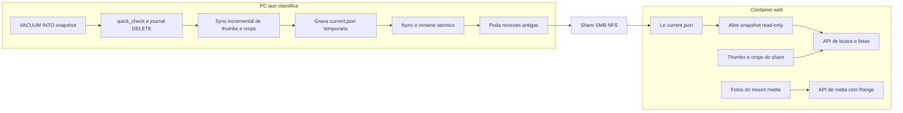

# Web client (leitura) para a biblioteca do Frank Sherlock

Plano para servir a biblioteca já processada em outro computador (PROXMOX) e no celular,
sem GPU e sem reprocessar nada. O desktop continua sendo o único que escreve no índice.

## 1. Decisões

| Tema | Decisão |
|------|---------|
| Transporte | Share SMB/NFS montado nos dois lados. O desktop copia **do local para a rede**; é a única cópia. |
| Destino | Uma pasta de publicação independente das pastas de fotos, escolhida nas Settings (`publish_dir`). Contém tudo: DB, thumbs, crops e o ponteiro de revisão. |
| Banco no web | Snapshot `index.<rev>.sqlite` **imutável**, aberto em modo `read-only`. Nunca o `index.sqlite` vivo, nunca WAL pela rede. |
| Leitura | Direto do mount, sem cópia local (flag `LIBRARY_COPY_TO_LOCAL` existe para shares lentos). |
| Escrita no web | Nenhuma no v1. A UI esconde scan, delete, rename, reclassificar e edição de metadados. |
| Múltiplas pastas de fotos | O pacote é único para toda a biblioteca (todos os roots). O web mapeia cada `root_path` gravado para um mount do container. |
| Backend web | Rust + axum, reusando o mesmo crates de busca/FTS/parser do desktop. |
| Frontend | Pacote `shared` (React + TS) consumido pelo desktop e pelo web via uma interface `LibraryClient`. |
| Empacotamento | Imagem Docker única (SPA embutida + axum), não-root, filesystem read-only, healthcheck. |
| Fotos ocultas | Coluna `files.hidden_at`; toggle "mostrar ocultas" só no desktop; nunca visível no web. |

### Por que não ler o banco vivo pela rede

`WAL` + share de rede significa locking advisory, `-wal`/`-shm` compartilhados e corrupção
provável em queda de conexão. Além disso o desktop escreve a cada arquivo do scan, então o
web veria um índice em movimento. O snapshot elimina as duas coisas.

## 2. Formato do pacote publicado

Escolhido no desktop em **Settings → Publicação**. Estrutura:

```
<PUBLISH_DIR>/
  current.json                        ponteiro da revisão ativa
  index.20261027T190200Z.sqlite       snapshot imutável, journal_mode=DELETE
  thumbs/
    <root_key>/<rel_path>.jpg         mesma árvore do cache local
  face_crops/
    <file_id>_<index>.jpg             achatado por basename
    <face_id>.jpg
```

`root_key` é exatamente `sha256(normalize_rel_path(root_path))[..16]` — a mesma função de
[`thumbnail.rs`](sherlock/desktop/src-tauri/src/thumbnail.rs:68). O basename dos crops é
único ([`face.rs`](sherlock/desktop/src-tauri/src/face.rs:929)), então achatá-los é seguro;
as thumbs **não** podem ser achatadas porque `rel_path` colide entre roots.

### `current.json`

```json
{
  "format": 1,
  "revision": "20261027T190200Z",
  "generatedAtUnix": 1793156520,
  "schemaVersion": 20,
  "database": { "file": "index.20261027T190200Z.sqlite", "bytes": 314572800, "sha256": "…" },
  "thumbnails": { "dir": "thumbs", "files": 55120, "bytes": 1234567890 },
  "faceCrops": { "dir": "face_crops", "files": 4210, "bytes": 98765432 },
  "roots": [
    { "id": 1, "name": "Fotos", "path": "/home/stephan/Fotos", "rootKey": "b3f1…", "files": 40000 }
  ],
  "publisher": { "app": "frank-sherlock", "version": "0.8.2", "host": "desktop" }
}
```

`roots` existe para o web detectar root não mapeado **sem** abrir o banco (health e banner
da UI). `schemaVersion` é o `PRAGMA user_version` do snapshot: o web recusa revisão mais nova
que ele entende, em vez de responder 500 em cada request.

### Publicação atômica e retenção

1. `VACUUM INTO` num arquivo temporário **na própria origem** (local, rápido e consistente),
   depois `PRAGMA journal_mode=DELETE` e `PRAGMA quick_check` no resultado.
2. Copia o `.sqlite` para `<PUBLISH_DIR>/index.<rev>.sqlite.tmp` e faz rename.
3. Sincroniza thumbs e crops incrementalmente (tamanho + mtime) e remove órfãos.
4. Só então escreve `current.json.tmp` → `fsync` → rename (best-effort `fsync` do diretório).
5. Poda revisões antigas, mantendo `keep_revisions` (padrão 2). Falha de remoção é `warn`,
   não erro: um leitor pode estar com o arquivo aberto.

Nunca sobrescrever `index.sqlite` em uso. Revisões versionadas + ponteiro evitam depender de
rename-over-open, que é justamente onde SMB se comporta diferente de POSIX.



## 3. Mapeamento banco x web

O banco guarda caminhos absolutos **da máquina que escaneia** (`files.abs_path`,
`files.thumb_path`, `face_detections.crop_path`). O snapshot preserva essa verdade: nada é
reescrito na publicação, para que dois consumidores possam ter mounts diferentes.

Na leitura, o web resolve por `file_id`, nunca por caminho vindo do cliente:

```
root          = roots[rootId]              // do próprio banco
media_path    = media_map[root.root_path] + "/" + rel_path
thumb_path    = LIBRARY_DIR/thumbs/root_key(root.root_path)/rel_path.jpg
face_crop     = LIBRARY_DIR/face_crops/basename(crop_path)
```

`media_map` é a única configuração de deploy (JSON ou env), porque o container não pode
escolher mounts em runtime — quem monta é o compose:

```json
[
  { "storedPath": "/home/stephan/Fotos",  "mountedPath": "/mnt/fotos" },
  { "storedPath": "/mnt/nas/Anime",       "mountedPath": "/mnt/anime" }
]
```

Root sem entrada no mapa não derruba a API: aparece em `/api/health` como `unmappedRoots` e
como banner na UI, e as buscas dentro dele devolvem `409` com mensagem clara.

Cada item de resultado sai com URLs resolvidas (`thumbUrl`, `mediaUrl`, `previewUrl`) para
que os componentes React não conheçam o filesystem:

```
GET /api/search  ->  { total, limit, offset, items: [{
  id, rootId, relPath, mediaType, description, confidence, mtimeNs, sizeBytes, faceCount,
  thumbUrl, mediaUrl, previewUrl, sourceFormat, sourceRelPath
}], parsedQuery }
```

`absPath` do desktop não vaza para o web. A tela de propriedades mostra `relPath` + nome do
root.

## 4. Contrato HTTP

| Rota | Função |
|------|--------|
| `GET /api/health` | revisão ativa, schema, roots mapeados/não mapeados, contagens |
| `GET /api/library` | metadados do `current.json` + stats |
| `GET /api/roots` | roots com contagem, disponibilidade e `mapped: bool` |
| `GET /api/subdirs?rootId&prefix` | árvore de diretórios |
| `GET /api/search` | mesmo `SearchRequest` do desktop |
| `GET /api/item/{id}` | metadados completos de um arquivo |
| `GET /api/albums`, `GET /api/albums/{id}/files` | álbuns (leitura) |
| `GET /api/smart-folders` | smart folders (leitura) |
| `GET /api/people`, `GET /api/people/{id}/files` | rostos agrupados (leitura) |
| `GET /api/duplicates` | grupos de duplicados (leitura, informativo) |
| `GET /api/thumb/{id}` | JPEG 300 px com `ETag` e cache longo |
| `GET /api/face-crop/{id}` | crop 150 px |
| `GET /api/media/{id}` | original com `Range` (vídeo/áudio/PDF) |
| `GET /api/media/{id}?w=1600` | derivado redimensionado, cacheado em disco |
| `GET /manifest.webmanifest` | PWA para instalar no celular |

O servidor já implementa todas as rotas acima exceto `?w=` e o manifest do PWA, que
entram junto com a UI: hoje `/api/media/{id}` entrega o original com `Range` via
`ServeFile`, e o manifest só faz sentido quando existe SPA para instalar.

Regras de mídia:

- `Range` obrigatório para vídeo (a lógica de [`video_server.rs`](sherlock/desktop/src-tauri/src/video_server.rs:58) é portada para axum).
- `?w=` limita a 4096 e usa cache `<CACHE_DIR>/<rev>/<id>_<w>.jpg`; é o que salva o celular
  de baixar um JPEG de 12 MP.
- Caminho resolvido é canonicalizado e precisa continuar sob o mount; symlink que escapa é
  `403`. Entrada inválida de `rootId`/`id` é `404`, sem detalhes de filesystem.
- PDF: v1 entrega download/`<iframe>` do original. Desbloqueio por senha fica no desktop —
  `pdf_passwords` **não** é exposto pela API.
- HEIC sem cópia convertida no índice: `415` com `thumbUrl` como fallback + botão de
  download.

## 5. Arquitetura do código

```
sherlock/
  core/           crate: error, models de leitura, query_parser, db, paths (thumb/root_key)
  desktop/        Tauri: consome core, mantém scan/classify/face/publish
  web/
    server/       crate axum: LibraryStore (core), media resolver, rotas, SPA embutida
    ui/           Vite app do navegador
  shared/         pacote npm: types, utils puros, componentes, LibraryClient
package.json      workspace npm (shared, desktop, web/ui)
```

`core` é um crate **standalone com path dependency**, não um membro de workspace. Um
workspace moveria os `[profile.dev]` do `src-tauri` para a raiz (perdendo silenciosamente o
`opt-level` que mantém o pipeline de imagem utilizável em dev), mudaria o `target/` que o CI
cacheia e trocaria o lockfile de lugar — tudo isso sem nenhum ganho, já que são só dois
consumidores. O preço é compilar o crate duas vezes; o código e os testes continuam escritos
uma vez só.

Por que o backend do web é Rust: a busca é `FTS5` com stemmer porter + `query_parser.rs` +
~2.000 linhas de SQL em [`db.rs`](sherlock/desktop/src-tauri/src/db.rs:3507). Reimplementar em
TS significa duas buscas que divergem. Extraindo o código, a paridade é estrutural e os 322
testes existentes passam a proteger os dois consumidores.

Extração em passos seguros (os dois primeiros já estão feitos):

1. `core::error` + `core::query_parser` + `core::paths` + `core::exif` + `core::similarity`,
   reexportados no desktop sob os caminhos antigos.
2. `core::models` com os row shapes; `ScanContext`, `VisionSettings`, `ScanOverrides` e
   `RuntimeStatus` ficam em `desktop::models` porque dependem de `config` e `platform`.
3. **`db.rs` move inteiro, mas só depois de tirar as dependências impuras.** A primeira
   inspeção mostrou que ele chama `classify::derived_confidence` (backfill de confiança) e
   `face::{FaceDetection, embedding_to_blob, blob_to_embedding, cosine_similarity}`
   (gravação de rostos e clustering). Mover o arquivo assim arrastaria o `ort`/ONNX Runtime
   para o crate que o container precisa compilar — o oposto do objetivo. A saída foi mover
   primeiro os itens **puros**, que são formato de índice e não inferência: o modelo de
   confiança (`classify::{ParseKind, VALID_MEDIA_TYPES, derived_confidence}`), o tipo de
   detecção e a álgebra dos embeddings (`face`), e a regra de caminho das thumbnails
   (`thumbnail::{root_key, thumb_path_for}`). Com isso `db.rs` e `platform/fs.rs` (o probe
   com timeout usado por `probe_roots`) vão inteiros para o core.
4. O desktop vira reexport: `pub use sherlock_core::{db, exif, …}` no `lib.rs` e reexports em
   `platform/{paths,fs}.rs`, `face.rs`, `classify.rs` e `thumbnail.rs`. Nenhum call site
   mudou, e os ~150 testes de banco foram junto sem serem reescritos.
5. `web::server` depende de `core` e nunca de `src-tauri`.

No frontend, o único acoplamento real com Tauri são `invoke` e `convertFileSrc` — hoje
espalhados em [`api.ts`](sherlock/desktop/src/api.ts:1), [`ImageTile.tsx`](sherlock/desktop/src/components/Content/ImageTile.tsx:17),
`PreviewModal`, `FacesView`, `DuplicatesView` e `PdfViewer`. A interface resolve os dois:

```ts
interface LibraryClient {
  capabilities: { write: boolean; scan: boolean; pdfUnlock: boolean };
  search(req: SearchRequest): Promise<SearchResponse>;
  listRoots(): Promise<RootInfo[]>;
  listSubdirs(rootId: number, prefix: string): Promise<SubdirEntry[]>;
  listAlbums(): Promise<Album[]>;
  listPeople(): Promise<PersonInfo[]>;
  listDuplicates(): Promise<DuplicatesResponse>;
  thumbUrl(item: SearchItem): string | null;
  mediaUrl(item: SearchItem): string;
  previewUrl(item: SearchItem, width: number): string;
  faceCropUrl(face: FaceInfo): string | null;
  pdfUrl(item: SearchItem): string;
}
```

- `tauriLibraryClient` = `api.ts` + `convertFileSrc` + `get_video_stream_url`.
- `httpLibraryClient` = `fetch` + URLs já resolvidas pelo servidor.

Componentes movidos para `shared`: `ImageTile`, `ImageGrid`, `Toolbar`, `ResultsMeta`,
`Sidebar` (com `RootCard`/`AlbumCard`/`SmartFolderCard` em modo leitura), `FacesView`,
`DuplicatesView`, `PreviewModal` (sem desbloqueio de PDF), `HelpModal`, `ToastContainer` e
`utils/*`. Ficam no desktop: `SettingsModal`, `SetupModal`, `ScanSummaryModal`,
`RawConversionModal`, `ModelPickerModal`, `Confirm*`, `RenameModal`, `EditMetadataModal` e o
`ContextMenu` completo.

Enquanto o refactor não termina, o desktop continua funcionando: cada componente migrado é
uma troca de import, coberta pelos testes atuais (que se movem junto).

## 6. Configuração do container

```
LIBRARY_DIR=/library                 mount do PUBLISH_DIR, read-only
MEDIA_MAP=/config/media.map.json     root_path gravado -> path no container
AUTH_TOKEN=…                          bearer exigido pela API
CACHE_DIR=/tmp/fs-web-cache          derivados de ?w=
LIBRARY_COPY_TO_LOCAL=false          true copia o snapshot para local ao abrir
POLL_SECONDS=5                       intervalo de checagem do current.json
```

```yaml
services:
  sherlock-web:
    image: ghcr.io/<owner>/frank-sherlock-web:latest
    restart: unless-stopped
    read_only: true
    tmpfs: [/tmp]
    environment: { LIBRARY_DIR: /library, MEDIA_MAP: /config/media.map.json, AUTH_TOKEN: ${TOKEN} }
    volumes:
      - /mnt/publish:/library:ro
      - /mnt/fotos:/mnt/fotos:ro
      - /mnt/anime:/mnt/anime:ro
      - ./config:/config:ro
    ports: ["8080:8080"]
    healthcheck: { test: ["CMD", "/app/sherlock-web", "--health"], interval: 30s }
```

Múltiplos shares de fotos = múltiplos bind mounts + entradas no `media.map.json`. Um mount só
não cobre roots em shares diferentes.

Auth/TLS: terminação no reverse proxy do PROXMOX (Caddy/Traefik) com Basic Auth ou
Authentik; o app valida `AUTH_TOKEN` como segunda barreira. Sem isso, qualquer device da LAN
lê a biblioteca inteira. `AUTH_TOKEN` vazio = modo aberto, apenas para debug, com `WARN` no
log.

## 7. Desktop: Settings

Nova seção **Publicação** (persistida em `config.json`, que já tem round-trip genérico via
`load_user_config`/`save_user_config`; `settings.toml` continua sendo só pipeline):

- Pasta de destino na rede (seletor nativo de diretório).
- Publicar automaticamente ao fim de cada scan (padrão: ligado).
- Incluir face crops (padrão: ligado).
- Manter N revisões (padrão: 2).
- Estado: última publicação, duração, bytes, contagem de thumbs copiadas, próximo passo.
- Botão **Publicar agora** com progresso e cancelamento.
- Diagnóstico: destino inacessível, espaço livre, `PUBLISH_DIR` dentro do cache, root cujo
  `root_path` deixou de existir.

Publicação roda em `spawn_blocking` (nunca na thread da UI) e é cancelável entre arquivos.

## 7.1 Fotos ocultas (ocultar no desktop, invisível no web)

**Schema.** Migration 20 em [`db.rs`](sherlock/desktop/src-tauri/src/db.rs:66):
`ALTER TABLE files ADD COLUMN hidden_at INTEGER;` mais
`CREATE INDEX idx_files_hidden_at`. `NULL` = visível. Timestamp em vez de booleano porque
permite ordenar por "ocultado recentemente", desfazer e saber **quando**; e não precisa de
backfill — toda linha existente já nasce visível.

**Preservação.** `upsert_file_record` grava uma lista explícita de colunas, então o scan não
zera `hidden_at`: a linha oculta continua sendo escaneada, reclassificada e com thumbnail
reparada. É exatamente a armadilha documentada na migration 19 (`raw_conversions`), e merece
teste próprio — escanear uma linha oculta duas vezes tem que deixá-la oculta. Mover/renomear
preserva (é a mesma linha); apagar e reindexar perde a marcação, o que é aceitável.

**Leitura.** `SearchRequest` ganha `include_hidden: bool` (default `false`). O filtro
`AND files.hidden_at IS NULL` entra em **todas** as consultas de leitura: os dois caminhos de
`search_images` (FTS e filtro simples), o `total` da busca, contagem por subdiretório,
`file_count` de root, arquivos de álbum, pessoas/rostos, grupos de duplicados e PDFs
protegidos. As linhas ocultas continuam no FTS: desocultar é um `UPDATE` e não depende de
rebuild do índice.

**Comandos.** `hide_files(file_ids)`, `unhide_files(file_ids)` e `hidden_count(scope)` — em
lote, uma transação, devolvendo quantas linhas mudaram. O desfazer da UI reusa o mesmo
comando com os ids devolvidos.

**UI desktop.** Botão de olho no [`ImageTile`](sherlock/desktop/src/components/Content/ImageTile.tsx:16)
(no hover, como os outros selos do tile) e item "Ocultar"/"Mostrar" no
[`ContextMenu`](sherlock/desktop/src/components/Content/ContextMenu.tsx:1). Toggle
**Mostrar ocultas** no [`Toolbar`](sherlock/desktop/src/components/Content/Toolbar.tsx:1),
persistido em `config.json` via `useUserConfig`, default desligado. Com o toggle ligado o
tile oculto ganha selo e opacidade reduzida, e o toast do "Ocultar" oferece desfazer. Esse
toggle é a única porta: nenhum outro ponto do desktop mostra ocultas por acidente.

**Web.** `include_hidden` **não** é parâmetro de query — o servidor fixa `false` e ignora o
que o cliente mandar. Além da busca, `/api/media/{id}`, `/api/thumb/{id}`,
`/api/face-crop/{id}` e `/api/item/{id}` devolvem `404` para linha oculta: ids são
enumeráveis, então filtrar só na busca deixaria a foto acessível por URL adivinhada.
`/api/health` reporta `hiddenFiles` para diagnóstico, sem revelar quais.

**O que continua valendo para uma linha oculta.** Ocultar é só um `UPDATE` em
`hidden_at`: nada é apagado nem marcado como `deleted_at`. O scan continua comparando
mtime/tamanho, detectando move, marcando arquivo sumido do share e reparando thumbnail;
a classificação, o OCR e a detecção de rostos continuam pegando essas linhas; `raw_conversions`
e o purge seguem iguais. O filtro existe **só** onde o olho humano chega: grade, contagens do
sidebar, álbuns, galeria de rostos, pessoas e duplicados.

Consequência a ter em mente: como a busca do Duplicates ignora ocultas, uma foto oculta deixa
de aparecer como candidata a duplicata — e, portanto, não pode ser oferecida para exclusão
naquela tela. É coerente com "não mostrar", mas é uma diferença real em relação a uma linha
visível. Já os contadores de trabalho (pendentes de classificação e de rostos) continuam
incluindo ocultas, senão o app diria que não há nada a fazer enquanto há trabalho pendente.

**Publicação.** O formato não muda: `hidden_at` viaja no snapshot e thumbs/crops de linhas
ocultas continuam publicados. Não publicá-los economizaria espaço, mas faria de cada toggle
um publish obrigatório — fica para depois, se o espaço incomodar.

## 8. Escopo

**v1:** busca com filtros e ordenação, grade com scroll infinito, sidebar de roots +
subdiretórios + álbuns + smart folders, visualização de rostos, duplicados informativos,
preview de imagem/vídeo (Range)/PDF (download), responsivo com drawer, PWA, Docker + CI.

**Depois:** escrita a partir do web (overlay de anotações que sobrevive à publicação),
transcodificação on-the-fly, cache local de thumbs, múltiplos usuários com permissões.

## 9. Riscos

| Risco | Mitigação |
|-------|-----------|
| Latência de leitura aleatória do SQLite sobre SMB | `LIBRARY_COPY_TO_LOCAL` (uma cópia sequencial ao abrir) |
| Prune apagar revisão em uso | manter 2 revisões + `warn` em falha de remoção |
| Componentes compartilhados quebrarem no desktop | migração um-a-um, testes existentes movidos junto, `capabilities` explícitas |
| Divergência de busca entre os dois apps | uma única implementação em `core`, testes no crate |
| Exposição acidental do filesystem | resolver por `id`, canonicalizar, validar prefixo do mount, nunca aceitar path do cliente |
| Mount esquecido ao adicionar root | `/api/health` lista `unmappedRoots`, banner na UI |
| Ocultação vazando pelo web | filtro fixo no read layer + `404` em `/api/media`, `/api/thumb`, `/api/face-crop` e `/api/item` |

## 10. Estado da implementação (handoff)

Branch `feat/web-client`, 2026-10-28 (terceira sessão).

**Feito e commitado (sessões anteriores)**

- Desktop: ocultação de fotos (migration 20), publicação com snapshot/revisões/ponteiro
  atômico, auto-publicação ao fim da cadeia de scans, seção Publicação nas Settings.
- `sherlock/core`: crate standalone com `error`, `query_parser`, `exif`, `similarity`,
  `paths`, `face`, `classify`, `thumbnail`, `models`, `db` e `fs`. O desktop só reexporta.
- `sherlock/web/server`: axum lendo `current.json`, `MediaMap` com validação de traversal,
  endpoints de leitura, auth por bearer ou `?token=`, 12 testes de integração.

**Feito nesta sessão (itens 3 e 4 da lista anterior)**

- Workspace npm na raiz ([`package.json`](package.json:1)): `sherlock/shared` +
  `sherlock/desktop`, um único `package-lock.json`. O `sherlock/desktop/package-lock.json`
  foi removido, e CI/release passaram a rodar `npm ci` na raiz. O CI também roda os testes e
  o `tsc` do `shared`.
- `sherlock/shared`: types de leitura (`SearchItem`, `SearchResponse`, `RootInfo`, álbuns,
  pessoas, rostos, duplicados, health), utils puros (`formatBytes`, `fileName`, `basename`,
  `errorMessage`, checagem de extensão), `LibraryClient` com `capabilities`,
  `LibraryProvider`/`useLibrary()` e `createHttpLibraryClient` (query string, token por
  header e por `?token=` nas mídias, `previewUrl` com `?w=` limitado a 4096). 18 testes.
- Desktop: [`types.ts`](sherlock/desktop/src/types.ts:1) e `utils*` reexportam o `shared` e
  só mantêm o que é específico (ex.: `absPath` obrigatório). O
  [`tauriLibraryClient`](sherlock/desktop/src/tauriLibraryClient.ts:1) implementa a interface
  sobre `api.ts` + `convertFileSrc`, montado no [`main.tsx`](sherlock/desktop/src/main.tsx:1).
  Nenhum call site mudou; os 427 testes continuam passando.
- Servidor: `/api/people`, `/api/faces/{id}` e `/api/duplicates` devolvem URLs
  (`cropUrl`, `thumbUrl`, `mediaUrl`) e nenhum caminho de host. A rota nova
  `/api/person-crop/{id}` serve o crop representativo por id, então nem o path do crop sai do
  servidor. 3 testes unitários novos.
- Início do item 5: `ImageTile`, `ImageGrid`, `Toolbar` e `ResultsMeta` movidos para
  `sherlock/shared/src/components`, com o CSS correspondente em `library.css` (o `Content.css`
  do desktop ficou só com o shell). O `ImageTile` resolve a thumbnail pelo `useLibrary()` e o
  botão de ocultar passou a exigir `capabilities.write`, então o web não pinta a ação mesmo
  se um callback for passado por engano.
- Continuação do item 5: `ModalOverlay`, `HelpModal`, `ToastContainer`, `AlbumCard`,
  `SmartFolderCard`, `DirectoryTree`, `DuplicatesView` e `PreviewModal` também foram para
  `shared/src/components`, cada um com o seu CSS (`modal.css`, `help-modal.css`, `toast.css`,
  `sidebar.css`, `tools.css`, `duplicates.css`, `preview.css`). O `DirectoryTree` consulta
  `client.listSubdirs`; o `DuplicatesView` resolve thumbnails pelo client, é genérico no tipo
  de grupo (o desktop mantém `absPath` obrigatório) e só mostra seleção/exclusão com
  `capabilities.write`; os cards de álbum/smart folder só renderizam o "x" quando o callback
  existe. O `ModalOverlay` ganhou um re-export no caminho antigo para não tocar os ~20 modais
  do desktop.
- `PreviewModal` agora usa `previewUrl(item, 1600)` para imagens e ganhou
  `videoUrl(item): Promise<string>` no `LibraryClient` (desktop pede ao servidor de stream
  local com fallback para o asset protocol; web devolve `/api/media` com `Range`). O PDF é um
  slot `renderPdf(item)`: o desktop injeta o `PdfViewer` com unlock, o web usa `<iframe>`
  same-origin + link de download.
- `FacesView` movido para `shared/src/components` (+ `faces.css`): leitura por
  `client.listPeople`/`listFacesForPerson`, crops por `personCropUrl`/`faceCropUrl`, e as
  ações de escrita num objeto `actions` opcional (`renamePerson`, `recluster`,
  `reclusterStatus`, `unassignFace`, `reassignFaces`, `setRepresentativeFace`). Sem `actions`
  ou com `capabilities.write` falso, renomear, re-cluster, menus de contexto e edição de
  rostos desaparecem. O desktop mantém [`FacesView.tsx`](sherlock/desktop/src/components/Content/FacesView.tsx:1)
  como wrapper que injeta as ações de `api.ts` e o provider; os 22 testes existentes passaram
  sem alteração.
- `Sidebar`/`RootCard` movidos para `shared` (+ `sidebar.css` com o shell e as regras de
  scan), junto com `useDragReorder`, `useSelection`, `useContextMenuClose` e `scanEta`
  (`computeEta`/`formatEta`). Os tipos do console (`ScanJobStatus`, `BacklogProgress`,
  `FaceDetectProgress`, `ThumbRepairProgress`, `DbStats`, `UpdateInfo`) foram para o shared e
  o desktop só reexporta; `RootInfo` compartilhado aceita as duas grafias (`name`/`rootName`,
  `path`/`rootPath`) e `Sidebar`/`RootCard` são genéricos no tipo do root, então o desktop
  continua inferindo o tipo rico. Os shims em `components/Sidebar/*`, `utils/scanEta` e
  `hooks/useDragReorder` preservaram os imports e os 40 testes de Sidebar.

**Feito nesta sessão (itens 1 e 2 da lista anterior)**

- `?w=` no `/api/media`: [`preview.rs`](sherlock/web/server/src/preview.rs:1) decodifica, reduz
  com Lanczos3 e publica um JPEG (qualidade 82) em
  `CACHE_DIR/<revision>/<id>_<width>.jpg` via arquivo temporário + rename, sempre em
  `spawn_blocking`. A largura é opcional e limitada a 4096; valor zero/inválido ou extensão que
  o decoder não lê servem o original (com `warn`, nunca `500`). O cache é namespaced pela
  revisão publicada. `CACHE_DIR` entrou no `Config` (default `/tmp/fs-web-cache`, criado no
  boot e validado como gravável).
- `ETag` + `If-None-Match` em thumbs, crops de rosto, crops de pessoa e derivados `?w=`;
  resposta `304` sem body, com `Cache-Control: public, max-age=604800`.
- Headers de segurança em todas as rotas: `X-Content-Type-Options: nosniff`,
  `Content-Security-Policy: frame-ancestors 'self'` e `X-Frame-Options: SAMEORIGIN`.
- `Range`: `ServeFile` responde `206` para range válido e `416` + `Content-Range: bytes */len`
  para range não satisfazível **ou** não parseável (os três formatos estão testados), sem
  panic e sem baixar o arquivo inteiro.
- O fixture dos testes de integração passou a usar um JPEG real (120×60), o que permite
  exercitar decode, resize, cache e `Range`. São 6 testes de integração e 6 unitários novos
  em `preview.rs`.

- `sherlock/web/ui` criado: Vite + React, `LibraryProvider` com
  `createHttpLibraryClient` (token de `?token=` ou localStorage, removido da URL depois),
  busca com debounce e scroll infinito (IntersectionObserver + botão de fallback), sidebar
  compartilhada em modo leitura (com drawer abaixo de 860 px), grid/toolbar/results, faces,
  duplicados exatos, preview (PDF via iframe) e o banner de `unmappedRoots` vindo de
  `/api/health`. PWA com manifest, ícones e service worker só do app shell; `/api` é sempre
  network-only.
- O `theme.css` passou para o `shared` e é exportado como
  `@frank-sherlock/shared/theme.css`.
- Cuidados que o web exigiu: `Sidebar` esconde o bloco de Info quando não há `dbStats` e os
  cards de álbum/smart folder não renderizam exclusão em modo leitura; `DuplicatesView` ganhou
  `showNearDuplicates` (o snapshot publicado só serve grupos exatos).

**Números no momento do handoff**: 241 no `core`, 294 no desktop (Rust), 43 no servidor web
(25 unitários + 18 de integração), 428 no frontend do desktop, 21 no `shared`, 5 no
`sherlock/web/ui`; `cargo fmt --check` e `cargo clippy -- -D warnings` limpos nos três
crates; `tsc --noEmit` limpo em `shared`, `desktop` e `web/ui`. Os itens 5 e 6 estão
completos.

**Próximo, em ordem**

1. Embarcar o `web/ui/dist` no binário axum (rota `/` servindo o SPA e fallback para
   `index.html`) — hoje a rota `/` ainda é o placeholder.
2. Dockerfile multi-stage, compose, job de CI da imagem e `docs/web-deploy.md` (incluir
   `CACHE_DIR` no tmpfs e `LIBRARY_DIR` read-only).
3. Validação ponta a ponta no celular.

**Invariantes que não podem quebrar**

- `include_hidden` nunca é lido do cliente; o servidor monta a requisição com `false`.
- Endpoints por id respondem `404` para linha oculta — indistinguível de deletada.
- Nenhuma rota aceita caminho vindo do cliente: resolve por id, passa pelo `MediaMap` e
  valida cada componente do `rel_path`.
- Pessoas, rostos e duplicados também são servidos por id/URL: nenhum `*Path` do host sai do
  servidor.
- Derivados `?w=` vivem em `CACHE_DIR` (tmpfs), nunca no mount read-only, e o nome inclui a
  revisão publicada — um cache antigo não pode servir uma thumbnail reparada.
- `db.rs` existe só no `core`. O desktop nunca deve ganhar uma cópia.
- Publicar jamais escreve o banco vivo na share: `VACUUM INTO` + revisões versionadas.
- Componente compartilhado nunca importa `@tauri-apps/*` nem `api.ts`: tudo passa por
  `useLibrary()`, e cada app monta o provider no seu `main.tsx`.
- Ação de escrita em componente compartilhado é opt-in duplo: o callback só é passado pelo
  app que pode escrever **e** o componente confere `capabilities.write` antes de renderizar.

